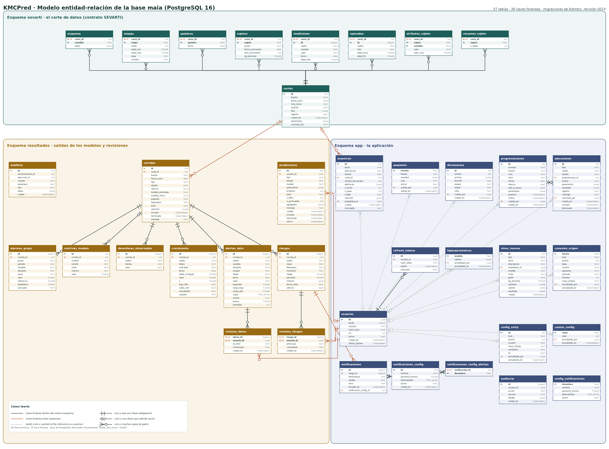
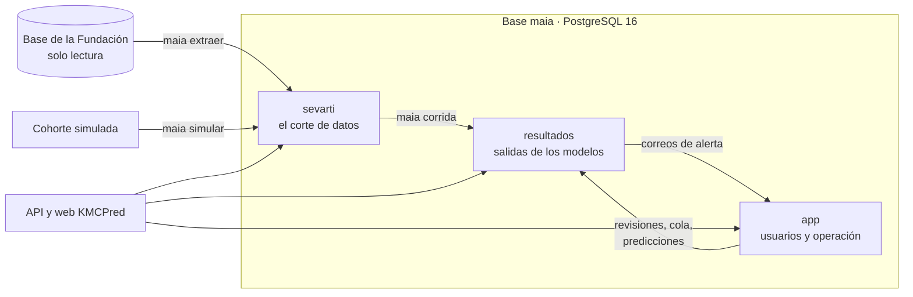
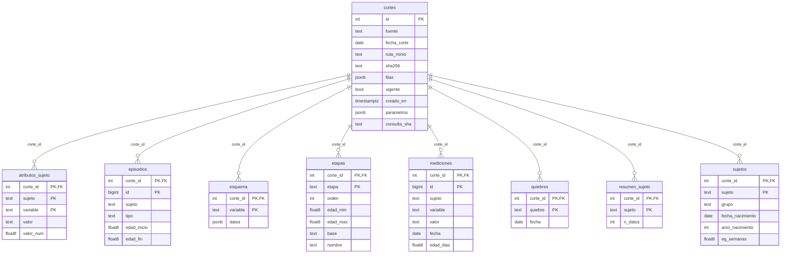
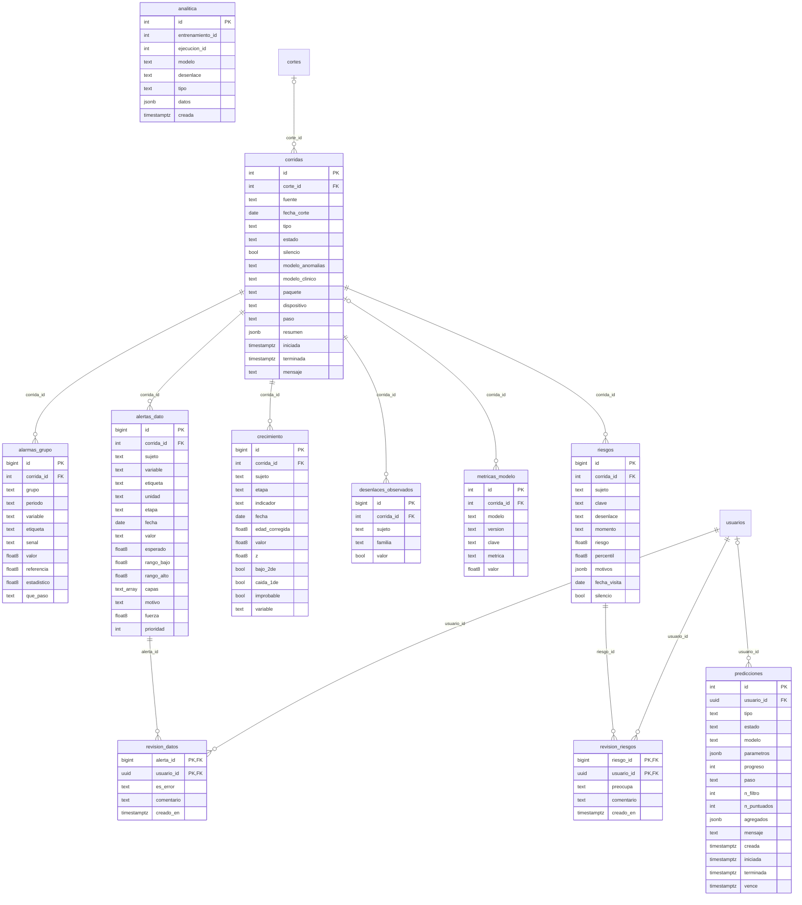

# Modelo de datos de la solución

DDL y DML de la base PostgreSQL de **KMCPred**. Todo sale de las 14 migraciones de Alembic del código
(`6-Codigo-Fuente-Proyecto/plataforma/comun/maia_comun/alembic/versions/`, revisión `0014`), aplicadas a
PostgreSQL 16 y exportadas con `pg_dump`. Los scripts se comprobaron cargándolos en una base vacía: producen la misma
estructura que las migraciones, sin diferencias, y Alembic la reconoce como `0014 (head)`.

> **Sin datos reales.** Los datos de esta carpeta son de ejemplo: una cuenta de administración con clave de ejemplo,
> el Diccionario de variables (que no tiene datos de pacientes) y una cohorte de 30 niños inventados. Los registros
> de la Fundación Canguro nunca salen del equipo que entrena.

## Diagrama entidad-relación

Las 37 tablas de la base `maia`, con todas sus columnas, y sus 36 llaves foráneas, en notación de pata de gallo.
Cada panel es un esquema. Las líneas en coral cruzan de un esquema a otro; las grises punteadas son referencias de
auditoría a `usuarios` (quién creó o cambió la fila).

[](diagramas/modelo_entidad_relacion.svg)

Haga clic en la imagen para abrir la versión [SVG](diagramas/modelo_entidad_relacion.svg), que se puede ampliar sin
perder nitidez. Más abajo hay un diagrama Mermaid por esquema con el mismo contenido
([sevarti](#esquema-sevarti--el-corte-de-datos), [resultados](#esquema-resultados--salidas-de-los-modelos),
[app](#esquema-app--la-aplicación)).

Cómo se leen las relaciones principales:

* **`sevarti.cortes` es la raíz de los datos.** Cada extracción crea un corte y todo lo extraído cuelga de él:
  sujetos, mediciones, episodios, etapas, el esquema de variables y los quiebres.
* **`resultados.corridas` es la raíz de las salidas.** Cada corrida apunta al corte que usó y de ella cuelgan las
  alertas de datos, los riesgos, el crecimiento, los desenlaces observados y las métricas.
* **Las revisiones unen a las personas con los resultados.** `revision_datos` y `revision_riesgos` tienen llave
  compuesta por la fila revisada y el usuario: una respuesta por experto.
* **`app.usuarios` es la raíz de la operación.** Sesiones, paquetes, Diccionario, configuración, programaciones y
  cola de ejecuciones guardan quién hizo cada cosa.
* **Las notificaciones cierran el ciclo.** Cada correo (`app.notificaciones`) apunta al riesgo que lo disparó y a la
  regla que lo envió.

## Contenido

```
Modelo-Datos-Solucion/
├── DDL/                                        Estructura (Data Definition Language)
│   ├── 00_base_de_datos_y_roles.sql            Bases maia y mlflow, y sus roles
│   ├── 01_extensiones_y_esquemas.sql           citext, pgcrypto, esquemas y tabla de versiones de Alembic
│   ├── 02_esquema_sevarti.sql                  9 tablas: el corte de datos (contrato SEVARTI)
│   ├── 03_esquema_resultados.sql               11 tablas: salidas de los modelos y revisiones
│   ├── 04_esquema_app.sql                      17 tablas y el tipo app.rol: la aplicación
│   ├── 05_llaves_restricciones_e_indices.sql   Llaves primarias, únicas y foráneas, e índices
│   ├── ddl_completo.sql                        01 a 05 en un solo archivo
│   └── migraciones/
│       └── historial_migraciones_alembic.sql   El SQL de las migraciones 0001 a 0014, en orden
├── DML/                                        Datos (Data Manipulation Language)
│   ├── 01_datos_iniciales.sql                  Lo que la API siembra al arrancar
│   ├── 02_cohorte_simulada.sql                 Un corte de demostración con 30 niños inventados
│   ├── 03_operaciones_de_la_aplicacion.sql     INSERT, UPDATE y DELETE de la operación diaria
│   └── 04_consultas_frecuentes.sql             SELECT que responden las preguntas de la solución
└── diagramas/
    ├── modelo_entidad_relacion.png             Diagrama entidad-relación completo
    └── modelo_entidad_relacion.svg             El mismo, en vectores (se amplía sin perder nitidez)
```

| Elemento | Cantidad |
|---|---|
| Esquemas de la aplicación | 3 (`sevarti`, `resultados`, `app`) |
| Tablas | 37, más `public.alembic_version` |
| Llaves foráneas | 36 (6 entre esquemas distintos) |
| Índices secundarios | 18 |
| Restricciones `CHECK` | 19 |
| Tipos enumerados | 1 (`app.rol`) |

## Cómo crear la base

Se necesita `psql` de PostgreSQL 16. Desde esta carpeta:

```bash
psql -U postgres -d postgres -v ON_ERROR_STOP=1 -v clave_maia='<clave>' -v clave_mlflow='<clave>' -f DDL/00_base_de_datos_y_roles.sql
```

```bash
psql -U maia -d maia -v ON_ERROR_STOP=1 -f DDL/ddl_completo.sql -f DML/01_datos_iniciales.sql -f DML/02_cohorte_simulada.sql
```

En lugar de `ddl_completo.sql` se pueden ejecutar `01` a `05` en ese orden. `05` va al final porque hay llaves
foráneas en ambos sentidos entre `app` y `resultados`.

Después:

* `psql -U maia -d maia -f DML/03_operaciones_de_la_aplicacion.sql` recorre las escrituras de la aplicación dentro de
  una transacción que termina en `ROLLBACK`: muestra lo que habría escrito y deja la base como estaba.
* `psql -U maia -d maia -f DML/04_consultas_frecuentes.sql` ejecuta las consultas. Las del esquema `resultados`
  devuelven filas cuando hay una corrida guardada.

**En la plataforma no hace falta nada de esto.** La API aplica las migraciones al arrancar (o `make migrar`) y siembra
los datos iniciales. Esta carpeta documenta el modelo y permite crearlo sin el código.

| Archivo | Requiere | Probado |
|---|---|---|
| `DDL/00` | Superusuario | Sí |
| `DDL/01` a `05` y `ddl_completo.sql` | Base `maia` vacía, con su dueño | Sí: misma estructura que las migraciones |
| `DML/01` | DDL completo | Sí: `alembic current` responde `0014 (head)` |
| `DML/02` | `DML/01` | Sí |
| `DML/03` | `DML/02` | Sí, con `ROLLBACK` y con `COMMIT` |
| `DML/04` | `DML/02` | Sí: las 17 consultas, con y sin corrida |

## Los tres esquemas



| Esquema | Quién escribe | Qué guarda |
|---|---|---|
| `sevarti` | La CLI `maia` al extraer o simular | Cada corte de datos con el contrato SEVARTI. Un corte nuevo no borra el anterior; `vigente` marca el que usa la aplicación |
| `resultados` | `maia corrida`, la API (revisiones y predicciones) | Alertas de datos, riesgos, crecimiento frente a la OMS, métricas y las respuestas de los expertos |
| `app` | La API | Usuarios y sesiones, paquetes de modelos, Diccionario, configuración, cola de ejecuciones, notificaciones y auditoría |

### Esquema `sevarti` · el corte de datos

| Tabla | Qué guarda |
|---|---|
| `cortes` | Cada extracción: fuente (`kmc` o `simulado`), fecha de corte, filas por tabla, huella del archivo y parámetros de la extracción |
| `esquema` | Las variables del corte, con su definición en JSON: tipo, unidad, visita, concepto, rango esperado y códigos |
| `etapas` | Las visitas del seguimiento como ventanas de edad, cronológica o corregida |
| `sujetos` | Un niño por fila: código seudonimizado, nacimiento y semanas de gestación |
| `mediciones` | Un dato por niño, variable y fecha, con la edad en días |
| `episodios` | Estancias (hospitalización, posición canguro) con su edad de inicio y fin |
| `quiebres` | Cambios conocidos en la forma de registrar, como el cambio de sistema de 2022 |
| `atributos_sujeto` | Primer y último valor válido de cada variable por niño; sirve para armar grupos |
| `resumen_sujeto` | Cuántos datos tiene cada niño |

`mediciones`, `episodios` y `atributos_sujeto` se relacionan con `sujetos` por `(corte_id, sujeto)` sin llave
foránea declarada: así se cargan millones de filas sin validar cada una.



### Esquema `resultados` · salidas de los modelos

| Tabla | Qué guarda |
|---|---|
| `corridas` | Cada ejecución: corte, paquete y versiones de los modelos, estado, si fue en silencio y su resumen |
| `alertas_dato` | Mediciones por revisar: el dato, lo esperado, el rango, las capas que lo marcaron, el motivo y la prioridad |
| `alarmas_grupo` | Señales de la capa 4: cambios sostenidos por grupo y trimestre (CUSUM) |
| `riesgos` | Riesgo calibrado por niño, desenlace y visita, con su nivel frente a los demás y sus tres motivos |
| `crecimiento` | Cada medida frente a la OMS: edad corregida, puntaje z y las marcas bajo −2 DE, caída de 1 DE e improbable |
| `desenlaces_observados` | Si el desenlace ocurrió, por niño; solo hay fila cuando se sabe |
| `metricas_modelo` | Métricas agregadas de cada modelo en la corrida |
| `analitica` | Artefactos agregados de la evaluación de cada entrenamiento (sin datos por niño) |
| `predicciones` | Estimaciones por grupo pedidas en la web: solo agregados, vencen en una hora |
| `revision_datos` | La respuesta del experto en datos a cada alerta: `si`, `no` o `no_se` |
| `revision_riesgos` | La respuesta del experto clínico en la revisión ciega: `si`, `no` o `no_se` |



### Esquema `app` · la aplicación

| Tabla | Qué guarda |
|---|---|
| `usuarios` | Cuentas con su perfil (`app.rol`: `admin`, `experto`, `datos`, `visualizador`) y la clave como hash Argon2 |
| `refresh_tokens` | Sesiones: el hash de cada token de refresco, su vencimiento y si fue revocado |
| `auditoria` | Quién hizo qué y cuándo |
| `paquetes` | Paquetes de modelos firmados que llegaron a la API; uno está `activo` |
| `diccionarios` | Versiones del Diccionario de variables (el Excel, en `bytea`); solo una `vigente` |
| `hiperparametros` | Los ajustes de administración para el próximo entrenamiento, por modelo |
| `cuotas_config` | Límites de «Mis modelos» |
| `conexion_origen` | Conexión a la base de la Fundación; la clave va cifrada |
| `programaciones` | Ejecuciones automáticas: expresión `cron`, zona horaria y opciones |
| `ejecuciones` | La cola del programador: corridas, entrenamientos y aprobaciones, con su estado y registro |
| `muestras` | Grupos de niños guardados desde Explorar: definición, tamaño y huella |
| `ninos_nuevos` | Niños y plantillas guardados en la estimación por grupo |
| `config_smtp` | El servidor de correo (una sola fila); la clave va cifrada |
| `notificaciones_config` | Reglas de alerta por correo: nombre, nivel mínimo y destinatarios |
| `notificaciones_config_alertas` | Qué desenlaces vigila cada regla |
| `notificaciones` | Cada correo enviado o fallido, una vez por riesgo y destinatario |
| `config_notificaciones` | Una fila inactiva por desenlace del paquete activo, que siembra la API |

```mermaid
erDiagram
    auditoria {
        bigint id PK
        uuid usuario_id
        text accion
        text recurso
        jsonb detalle
        timestamptz creado_en
    }
    conexion_origen {
        text fuente PK
        text host
        int puerto
        text base
        text usuario
        text esquema
        text sslmode
        int timeout
        text clave_cifrada
        uuid actualizado_por FK
        timestamptz actualizado_en
    }
    config_notificaciones {
        text desenlace PK
        text nombre
        float8 percentil_minimo
        text_array destinatarios
        bool activo
    }
    config_smtp {
        int id PK
        text host
        int puerto
        text usuario
        text clave_cifrada
        text remitente
        bool tls
        uuid actualizado_por FK
        timestamptz actualizado_en
    }
    cuotas_config {
        text clave PK
        int valor
        uuid actualizado_por FK
        timestamptz actualizado_en
    }
    diccionarios {
        int id PK
        int version
        bytea archivo
        text sha256
        text estado
        text origen
        text nota
        uuid creado_por FK
        timestamptz creado_en
    }
    ejecuciones {
        int id PK
        text tipo
        text origen
        text estado
        int programacion_id FK
        text fuente
        jsonb parametros
        jsonb resultado
        text registro
        text mensaje
        uuid solicitada_por FK
        timestamptz creada_en
        timestamptz iniciada
        timestamptz terminada
    }
    hiperparametros {
        text modelo PK
        jsonb valores
        uuid actualizado_por FK
        timestamptz actualizado_en
    }
    muestras {
        int id PK
        text titulo
        text descripcion
        text fuente
        int corte_id FK
        int version_diccionario
        jsonb definicion
        int n_ninos
        int n_base
        text huella
        jsonb resumen
        uuid propietario_id FK
        timestamptz creada
        bool inmutable
    }
    ninos_nuevos {
        int id PK
        text tipo
        text titulo
        text descripcion
        uuid propietario_id FK
        text modelo
        text visita
        text perfil
        float8 eg_semanas
        jsonb cambios
        jsonb valores
        jsonb resultado
        timestamptz creada
    }
    notificaciones {
        bigint id PK
        bigint riesgo_id FK
        text destinatario
        text estado
        text error
        timestamptz enviado_en
        int notificacion_config_id FK
    }
    notificaciones_config {
        int id PK
        text nombre
        float8 percentil_minimo
        text_array destinatarios
        bool activo
        timestamptz creado_en
    }
    notificaciones_config_alertas {
        int notificacion_id PK, FK
        text desenlace PK
    }
    paquetes {
        text version PK
        text fuente
        jsonb manifest
        text ruta
        bool activo
        uuid subido_por FK
        timestamptz subido_en
    }
    programaciones {
        int id PK
        text nombre
        text fuente
        text cron
        text zona
        bool activo
        bool silencio
        bool solo_si_nuevo
        jsonb parametros
        timestamptz proxima
        timestamptz ultima
        uuid creado_por FK
        timestamptz creado_en
    }
    refresh_tokens {
        uuid id PK
        uuid usuario_id FK
        text hash_token
        timestamptz expira
        bool revocado
    }
    usuarios {
        uuid id PK
        citext email
        text nombre
        text hash_clave
        rol rol
        bool activo
        timestamptz creado_en
        timestamptz ultimo_ingreso
    }
    usuarios |o--o{ conexion_origen : "actualizado_por"
    usuarios |o--o{ config_smtp : "actualizado_por"
    usuarios |o--o{ cuotas_config : "actualizado_por"
    usuarios |o--o{ diccionarios : "creado_por"
    programaciones |o--o{ ejecuciones : "programacion_id"
    usuarios |o--o{ ejecuciones : "solicitada_por"
    usuarios |o--o{ hiperparametros : "actualizado_por"
    cortes |o--o{ muestras : "corte_id"
    usuarios |o--o{ muestras : "propietario_id"
    usuarios |o--o{ ninos_nuevos : "propietario_id"
    notificaciones_config |o--o{ notificaciones : "notificacion_config_id"
    riesgos ||--o{ notificaciones : "riesgo_id"
    notificaciones_config ||--o{ notificaciones_config_alertas : "notificacion_id"
    usuarios |o--o{ paquetes : "subido_por"
    usuarios |o--o{ programaciones : "creado_por"
    usuarios ||--o{ refresh_tokens : "usuario_id"
```



### Relaciones entre esquemas

| Tabla | Columna | Apunta a |
|---|---|---|
| `app.muestras` | `corte_id` | `sevarti.cortes` |
| `app.notificaciones` | `riesgo_id` | `resultados.riesgos` |
| `resultados.corridas` | `corte_id` | `sevarti.cortes` |
| `resultados.predicciones` | `usuario_id` | `app.usuarios` |
| `resultados.revision_datos` | `usuario_id` | `app.usuarios` |
| `resultados.revision_riesgos` | `usuario_id` | `app.usuarios` |
