# KMCPred · Proyecto MAIA

> **Sistema interpretable de alertas y predicción temprana de riesgos en niños prematuros y de bajo peso del
> Programa Madre Canguro.**

## Introducción

El Programa Madre Canguro sigue a cada niño prematuro o de bajo peso con controles a las 40 semanas y a los 3, 6, 9 y
12 meses de edad corregida. Ese seguimiento deja una historia clínica longitudinal valiosa y difícil de usar: datos
faltantes, cambios de unidades, errores de captura y un cambio del sistema de registro en 2022.

**KMCPred** es la plataforma de inteligencia artificial que construimos con la Fundación Canguro para aprovechar esa
historia. Responde dos preguntas, en este orden:

1. **¿Este dato está bien anotado?** Un detector de anomalías de cinco capas revisa cada medición y arma la lista
   que revisan los expertos.
2. **¿Este niño va hacia un desenlace que se puede prevenir?** Clasificadores calibrados estiman el riesgo en cada
   visita, solo con lo que se sabía hasta ese momento, y dicen qué fue lo que más pesó.

Se desarrolló con el Observatorio Canguro: **62.043 niños y 13.884.056 mediciones** (corte del 24/07/2026), organizados
con el modelo conceptual SEVARTI (*Stages–Episodes–Variables–Topics of Interest*).

| Etapa | Técnica | Resultado principal |
|---|---|---|
| **1. Calidad del dato** | Validez, valores atípicos robustos (MAD), LightGBM cuantílico con calibración conformal, trayectoria entre visitas y CUSUM por trimestre | Encuentra el **83,6 %** de los errores inyectados en niños que no vio al entrenar, con unas 65 alertas por cada 1.000 registros sin alterar |
| **2. Riesgo clínico** | LightGBM por desenlace y visita, calibración isotónica y explicación TreeSHAP; crecimiento frente a los estándares OMS | Talla baja a los 12 meses: **AUROC 0,79 a 0,93** según la visita (referencia: 0,59 a 0,61). Desarrollo psicomotor bajo a los 12 meses, estimado a los 6: **AUROC 0,77** (referencia: 0,62) |

La solución completa (API, aplicación web, entrenamiento reproducible y trazabilidad con MLflow) está desplegada en
**<https://maia.canbby.com>**.

> **Apoyo a la decisión, no diagnóstico.** Los resultados son retrospectivos; se requiere validación clínica
> prospectiva antes de cualquier uso asistencial.

| | |
|---|---|
| **Nombre del proyecto** | KMCPred (Proyecto MAIA) |
| **Programa** | Maestría en Inteligencia Artificial, Universidad de los Andes (Bogotá, Colombia) |
| **Aliado** | Fundación Canguro · Observatorio Canguro |
| **Aplicación desplegada** | <https://maia.canbby.com> (el ingreso exige usuario y contraseña) |
| **Repositorio** | <https://github.com/breinergonza/proyecto-maia> |
| **Informe final** | [`5-Informe-final-latex/articulo.pdf`](5-Informe-final-latex/articulo.pdf) |

## Integrantes

| Nombre | Correo |
|---|---|
| Alex Paul Chirino Caicedo | a.chirino@uniandes.edu.co |
| Breitner Enrique González Angarita | b.gonzalez@uniandes.edu.co |
| Santiago José Ramos Echeverry | s.ramose@uniandes.edu.co |
| Wilfrido Alberto Gómez Pérez | w.gomezp@uniandes.edu.co |

Con el acompañamiento de la Fundación Canguro y del profesor José Tiberio Hernández (responsable de Analítica).

---

## Contenido

1. [Mapa de la entrega y de la rúbrica](#1-mapa-de-la-entrega-y-de-la-rúbrica)
2. [Estructura del repositorio](#2-estructura-del-repositorio)
3. [La solución de inteligencia artificial](#3-la-solución-de-inteligencia-artificial)
4. [Arquitectura de software](#4-arquitectura-de-software)
5. [Funcionamiento](#5-funcionamiento)
6. [Documentación del despliegue](#6-documentación-del-despliegue)
7. [Parametrización](#7-parametrización)
8. [Usabilidad y presentación de la información](#8-usabilidad-y-presentación-de-la-información)
9. [Operación y mantenimiento](#9-operación-y-mantenimiento)
10. [Límites y uso responsable](#10-límites-y-uso-responsable)
11. [Documentación relacionada](#11-documentación-relacionada)

---

## 1. Mapa de la entrega y de la rúbrica

Esta tabla dice dónde está cada cosa que pide la entrega y cómo comprobarla.

| Requisito | Dónde está | Cómo comprobarlo |
|---|---|---|
| Carpeta **Notebooks** | [`1-Notebooks/`](1-Notebooks/README.md) | Tres cuadernos (análisis, entrenamiento y pruebas de cada modelo) con su `.html` ya ejecutado |
| Carpeta **Modelos** | [`2-Modelos/`](2-Modelos/README.md) | `maia-anomalias/v8` y `maia-clinico/v9`: ficha de cada modelo y enlace de descarga del `.pkl` |
| Carpeta **Datos** | [`3-Datos/`](3-Datos/README.md) | `diccionario.xlsx` (estructura de los datos usados, sin datos de pacientes) y `Modelo-Datos-Solucion/`, con el DDL y el DML de la base |
| Nombre del proyecto e integrantes | [Introducción](#introducción) e [Integrantes](#integrantes) | Inicio de este documento |
| **Funcionamiento** (35) | [Sección 5](#5-funcionamiento) | Aplicación en <https://maia.canbby.com>, prueba de humo local en tres comandos y 1.324 pruebas automáticas |
| **Documentación del despliegue** (15) | [Sección 6](#6-documentación-del-despliegue) | Dependencias, entornos, pasos de despliegue, credenciales de ejemplo y ejemplos de uso |
| **Parametrización** (15) | [Sección 7](#7-parametrización) | Variables de entorno (`.env`), hiperparámetros, Diccionario y configuración desde la web |
| **Usabilidad y presentación** (35) | [Sección 8](#8-usabilidad-y-presentación-de-la-información) | Recorrido por perfil, capturas y criterios de diseño |

Las tres carpetas obligatorias llevan un número delante (`1-`, `2-`, `3-`) solo para que aparezcan primero y en orden
al abrir el repositorio.

---

## 2. Estructura del repositorio

```
proyecto-maia/
├── 1-Notebooks/                 Notebooks: análisis, entrenamiento y pruebas
├── 2-Modelos/                   Modelos: modelos finales y sus fichas
├── 3-Datos/                     Datos: estructura de los datos usados y modelo de datos (DDL y DML)
├── 4-Insumos-Proyecto/          Núcleo de datos y modelos, plan, avances y artículo previo
├── 5-Informe-final-latex/       Informe final (IEEEtran) con su PDF
├── 6-Codigo-Fuente-Proyecto/    Plataforma: núcleo, CLI, API, web e infraestructura
├── .github/workflows/           Integración continua
└── README.md                    Este documento
```

### 2.1 Notebooks

| Cuaderno | Qué contiene |
|---|---|
| [`informe_analisis_datos.ipynb`](1-Notebooks/informe_analisis_datos.ipynb) | **Análisis.** El mapa de los datos: qué hay, qué tan confiable es y qué cosas raras aparecen |
| [`modelo_anomalias.ipynb`](1-Notebooks/modelo_anomalias.ipynb) | **Entrenamiento y pruebas** del detector de anomalías: un modelo por variable, errores inyectados en tres rondas y revisión de toda la base |
| [`alertas_clinicas.ipynb`](1-Notebooks/alertas_clinicas.ipynb) | **Entrenamiento y pruebas** de las alertas clínicas: desenlaces, validación temporal, calibración y comparación con una regla simple |

Cada cuaderno tiene al lado su `.html` con todos los resultados y gráficos, para leerlo sin ejecutar nada. Los
cuadernos se generan con `construir_*.py`, de modo que el texto y el código quedan versionados como código fuente.
Solo muestran resultados agregados.

### 2.2 Modelos

| Modelo | Versión | Qué es | Archivos |
|---|---|---|---|
| `maia-anomalias` | `v8` (`9eea708fbf`) | Detector de anomalías: 132 modelos contextuales, α = 0,05 | `ficha.json`, `mascara_9eea708fbf.csv.gz`, `modelo.pkl.txt` |
| `maia-clinico` | `v9` (`c299096a71`) | Cinco clasificadores de riesgo a los 12 meses | `ficha.json`, `modelo.pkl.txt` |

Los dos se entrenaron el 23/11/2026 con el corte del 24/07/2026. Los nombres de las carpetas son los del registro de
modelos de MLflow. `maia-clinico/v9` es el entrenamiento más reciente y está registrado como `candidato`; la
instancia desplegada usa el `v8`, del 21/11/2026, con la misma configuración y la misma huella (`c299096a71`).

* **`ficha.json`** es la ficha del modelo (*model card*): versión, fecha, corte de datos, configuración completa y
  métricas de validación. Se lee sin descargar nada.
* **`modelo.pkl.txt`** contiene la dirección de descarga del `modelo.pkl`. El archivo serializado pesa demasiado para
  el repositorio; se descarga y se guarda al lado con el nombre `modelo.pkl`
  ([instrucciones](2-Modelos/README.md#cómo-obtener-un-modelo)).

La plataforma no carga estos `.pkl` sueltos. Solo abre modelos que llegan dentro de un **paquete firmado** (ver
[4.3](#43-ciclo-de-vida-de-un-modelo)), porque un archivo `pickle` ejecuta código al leerse.

### 2.3 Datos

Los registros clínicos están protegidos por un acuerdo de confidencialidad con la Fundación Canguro y no salen del
equipo que entrena. Por eso la carpeta entrega la **estructura** de los datos, no los datos:

* [`3-Datos/diccionario.xlsx`](3-Datos/diccionario.xlsx): el diccionario de variables que mantienen los expertos.
  Hojas Instrucciones, Variables, Visitas, Episodios, Quiebres, Desenlaces, Crecimiento y Curva OMS. Trae 318
  variables en estado «Lista» y 52 desenlaces. No tiene datos de pacientes.
* **Contrato de datos SEVARTI.** Todo entra a los modelos como seis tablas: esquema de variables, etapas, sujetos,
  mediciones, episodios y quiebres (cambios conocidos en la forma de registrar). El contrato está en
  [`sevarti/contrato.py`](6-Codigo-Fuente-Proyecto/nucleo/sevarti/contrato.py).
* **Muestra para probar.** `make demo-entrenar` genera una cohorte simulada de 5.000 niños con esa misma
  estructura. Con ella se puede ejecutar todo sin acceso a datos reales.
* **Modelo de datos de la solución.** [`3-Datos/Modelo-Datos-Solucion/`](3-Datos/Modelo-Datos-Solucion/README.md)
  tiene la base PostgreSQL como scripts SQL, generados desde las migraciones y probados en PostgreSQL 16:
  * `DDL/`: bases y roles, extensiones, los esquemas `sevarti`, `resultados` y `app` (37 tablas), llaves e índices,
    un script consolidado y el historial de las 14 migraciones.
  * `DML/`: datos iniciales, una cohorte de 30 niños inventados, las operaciones de la aplicación (`INSERT`,
    `UPDATE`, `DELETE`) y consultas frecuentes.

  Su README trae los diagramas entidad-relación de cada esquema.

---

## 3. La solución de inteligencia artificial

### 3.1 Formulación del problema

| | Etapa 1 · Calidad del dato | Etapa 2 · Riesgo clínico |
|---|---|---|
| **Tipo de problema** | Detección de anomalías sin etiquetas | Clasificación binaria supervisada |
| **Unidad de análisis** | Una medición (niño, variable, visita) | Un niño en una visita, para un desenlace |
| **Salida** | Alerta con su motivo y su capa | Probabilidad calibrada, nivel frente a los demás niños y motivos |
| **Quién la usa** | Experto en datos | Equipo clínico |
| **Cómo se evalúa** | Errores inyectados en niños que el modelo no vio | Prueba temporal con los niños nacidos más recientemente |

El orden importa: la etapa 2 aprende de los datos que la etapa 1 ya revisó.

### 3.2 Datos y partición

* **Fuente:** base PostgreSQL del Observatorio Canguro, con acceso de solo lectura.
* **Corte:** 24/07/2026. 62.043 niños. El modelo de anomalías usó 13.094.438 mediciones de 318 variables.
* **Partición por niño**, nunca por fila, para que ningún niño esté a la vez en entrenamiento y en prueba:
  40.711 niños en entrenamiento, 7.330 en calibración y 8.955 en prueba.
* **Orden temporal:** la prueba son los niños nacidos más recientemente, apartados antes de entrenar. La calibración
  del modelo clínico usa a los nacidos de 2023 a 2025, posteriores al cambio de sistema de 2022.
* **Sin imputación:** los faltantes se dejan explícitos. LightGBM los maneja de forma nativa y así la limpieza no
  esconde problemas reales.
* **Edad corregida:** edad posnatal en días menos 7 × (40 − semanas de gestación).

### 3.3 Flujo de los datos a la alerta

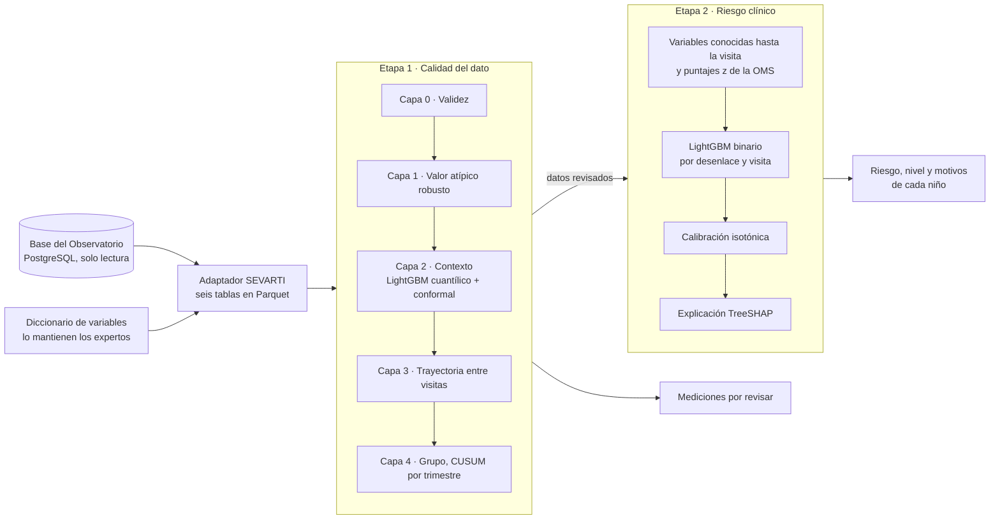

### 3.4 Etapa 1 · Detección de anomalías

| Capa | Qué pregunta | Técnica |
|---|---|---|
| 0 · Validez | ¿El tipo, la unidad y la fecha son posibles? | Reglas del Diccionario |
| 1 · Valor | ¿El valor es raro para esa variable? | z robusto con mediana y MAD; alerta desde 3,5 |
| 2 · Contexto | ¿Es raro **para este niño**, dados sus antecedentes y su visita? | LightGBM cuantílico (Q0,25, Q0,50 y Q0,75) y umbral conformal α = 0,05. El modelo no recibe el valor que revisa |
| 3 · Trayectoria | ¿Cuadra con las visitas anteriores? | Cambio entre visitas; medidas que no pueden bajar (talla, perímetro cefálico) |
| 4 · Grupo | ¿Cambió la forma de registrar? | CUSUM por trimestre (k = 0,5; h = 8) sobre residuos, faltantes y redondeos |

**Validación.** Se inyectan seis tipos de error conocido en los niños de prueba y se compara con la alternativa que
existía, las reglas de rangos del Diccionario. Cifras de la ficha `v8`:

| Error inyectado | Reglas de rangos | KMCPred |
|---|---|---|
| Código equivocado | 97,3 % | 99,3 % |
| Unidad equivocada | 56,1 % | 91,6 % |
| Desvío de 3 desviaciones estándar | 24,9 % | 90,1 % |
| Dígitos invertidos | 42,4 % | 84,2 % |
| Visitas intercambiadas | 5,9 % | 76,8 % |
| Valor de otro niño | 1,0 % | 53,3 % |

El costo son las alertas sobre datos sanos: 64,8 por cada 1.000 registros sin alterar, frente a 14,7 de las reglas.
Ese costo se gradúa con un solo parámetro, `alpha`:

| `alpha` | Errores encontrados | Alertas por 1.000 registros sin alterar |
|---|---|---|
| 0,001 | 72,9 % | 15,2 |
| 0,005 | 75,6 % | 18,9 |
| 0,01 | 77,4 % | 23,6 |
| 0,02 | 79,6 % | 33,1 |
| 0,05 (en uso) | 83,6 % | 64,8 |

Con `alpha` = 0,001 el detector genera casi las mismas alertas que las reglas de rangos y aun así encuentra el 72,9 %
de los errores. El valor definitivo lo deciden los expertos con la precisión que midan al revisar
([sección 7.3](#73-hiperparámetros-de-los-modelos)).

> El informe final describe la versión 7 del detector (83,6 % y 65,1 alertas por 1.000). La ficha publicada en
> `2-Modelos/` es la versión 8, un entrenamiento posterior con el mismo `alpha`.

### 3.5 Etapa 2 · Riesgo clínico

Un clasificador LightGBM por cada par (desenlace, visita). Cada uno ve solo lo medido hasta su visita: antecedentes
al nacer, episodios y controles anteriores. Cifras de la ficha `v9`, en niños que el modelo no vio:

| Desenlace a los 12 meses | Se estima a | Niños (casos) | AUROC | AUROC de referencia | PR-AUC | Sensibilidad | Precisión |
|---|---|---|---|---|---|---|---|
| Desarrollo psicomotor bajo | 6 meses | 2.343 (109) | **0,77** | 0,62 | 0,21 | 42,2 % | 19,7 % |
| Talla baja para la edad | 40 semanas | 2.072 (365) | **0,79** | 0,61 | 0,43 | 29,9 % | 52,7 % |
| Talla baja para la edad | 3 meses | 2.625 (510) | **0,86** | 0,60 | 0,60 | 36,3 % | 70,6 % |
| Talla baja para la edad | 6 meses | 2.420 (461) | **0,91** | 0,59 | 0,73 | 42,5 % | 81,0 % |
| Talla baja para la edad | 9 meses | 2.210 (417) | **0,93** | 0,60 | 0,80 | 46,8 % | 88,2 % |

* **Referencia:** una regla simple con la edad gestacional y los pesos al nacer, evaluada en los mismos niños.
* **Sensibilidad y precisión** se miden alertando al 10 % de niños con mayor riesgo, el mismo punto que usa la
  aplicación.
* **Lectura:** el modelo mejora con cada control, pero estimar más tarde deja menos tiempo para actuar. Por eso se
  entregan las cuatro visitas y no solo la mejor.
* El informe final y la ficha del modelo en la aplicación dan además el intervalo de confianza del 95 % de cada
  AUROC: 0,72 a 0,81; 0,77 a 0,81; 0,84 a 0,87; 0,89 a 0,92 y 0,92 a 0,94, en el orden de la tabla.

En la aplicación, el desarrollo psicomotor bajo está **En uso** y la talla baja **En prueba**: se calcula y se
muestra con esa etiqueta, y todavía no genera alertas.

### 3.6 Decisiones de modelado

| Decisión | Motivo |
|---|---|
| **LightGBM** en las dos etapas | Datos tabulares con tipos mixtos y muchos faltantes; entrena en GPU; admite explicación exacta con TreeSHAP |
| **Un modelo por desenlace y visita** | Cada estimación usa solo lo conocido en esa visita. Las variables que se llenan más tarde (`variables_tardias` en la ficha) quedan fuera, para que el modelo no vea el futuro |
| **Calibración isotónica** con los niños más recientes | Un riesgo de 20 % debe significar que cerca de 20 de cada 100 niños tienen el desenlace. Calibrar con datos posteriores a 2022 absorbe el cambio de sistema |
| **Umbral conformal** en la capa 2 | Fija cuántas alertas se aceptan sobre datos sanos, sin suponer una distribución |
| **Comparar siempre con una regla simple** | La mejora se mide contra lo que el equipo clínico ya podía hacer sin un modelo |
| **Sin búsqueda automática de hiperparámetros** | Hay pocos casos positivos (entre 109 y 510 en prueba). Se prefirió regularizar: tasa de aprendizaje baja, parada temprana, mínimo de niños por hoja y muestreo del 80 % |
| **Modelos En prueba y corrida en silencio** | Un modelo nuevo se puede calcular sin mostrarlo ni enviar correos, y comparar después con lo que pasó |
| **Revisión ciega por expertos** | El experto responde sin ver el riesgo. Así se mide si el modelo ordena bien, sin influir en quien responde |

### 3.7 Reproducibilidad

* Semillas fijas (7 y 11) y versiones exactas en `uv.lock`.
* Cada entrenamiento deja su `ficha.json` y queda registrado en MLflow con sus parámetros (`cfg.*`), sus métricas
  agregadas y sus artefactos.
* Cada modelo lleva una huella (`version` en la ficha, `version_modelo` en MLflow): dos entrenamientos con la misma
  configuración y el mismo corte la comparten.
* El paquete que llega a la aplicación lleva el hash de cada archivo y las versiones del código y de LightGBM.

---

## 4. Arquitectura de software

### 4.1 Vista de contenedores

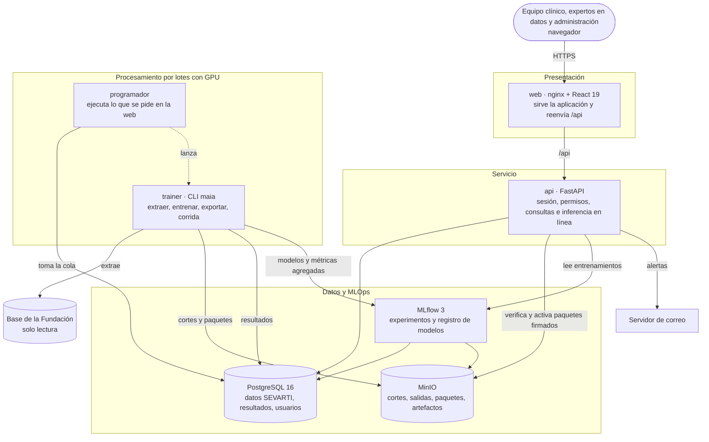

| Contenedor | Responsabilidad | Tecnología |
|---|---|---|
| `web` | Aplicación de una sola página y proxy de `/api` | React 19, TypeScript, Vite, Tailwind 4, Recharts, nginx |
| `api` | Sesión, permisos por perfil, consultas, inferencia en línea y administración | FastAPI, SQLAlchemy 2, Pydantic 2 |
| `trainer` | Extracción, entrenamiento, exportación y corrida semestral | CLI `maia` (Typer), LightGBM con CUDA |
| `programador` | Cola de ejecuciones y aprobaciones pedidas en la web | La misma imagen del trainer |
| `postgres` | Datos SEVARTI cargados, resultados, usuarios, auditoría y la base de MLflow | PostgreSQL 16, migraciones Alembic |
| `minio` | Cortes en Parquet, salidas en Excel, paquetes de modelos y artefactos de MLflow | Almacenamiento compatible con S3 |
| `mlflow` | Experimentos, métricas y registro de modelos con alias `candidato` y `produccion` | MLflow 3 |

### 4.2 Organización del código

Monorepo con un *workspace* de `uv` y dependencias en una sola dirección:

```
web  ──(contrato OpenAPI)──▶  api  ──▶  comun  ──▶  nucleo
                    entrenamiento  ──▶  comun  ──▶  nucleo
```

| Módulo | Ruta en `6-Codigo-Fuente-Proyecto/` | Responsabilidad |
|---|---|---|
| **Núcleo** | `nucleo/` | El contrato SEVARTI y los dos modelos. Es genérico: no nombra ninguna variable de la Fundación. Lo único específico de la base es el adaptador `sevarti/kmc.py` |
| **Común** | `plataforma/comun/` | Configuración, base de datos y migraciones, almacén de objetos, paquetes firmados, cifrado, correo y puntuación |
| **Entrenamiento** | `plataforma/entrenamiento/` | La CLI `maia` |
| **API** | `plataforma/api/` | 20 grupos de rutas bajo `/api` |
| **Web** | `plataforma/web/` | La aplicación. Sus tipos se generan del contrato `infra/openapi.json` |
| **Infraestructura** | `infra/` | Dockerfiles, `docker compose` local y on-premise, guía de Railway |

El núcleo recibe los datos por un contrato y no por una conexión. Cambiar de fuente (la base real, una cohorte
simulada, otra institución) es escribir otro adaptador, sin tocar los modelos.

### 4.3 Ciclo de vida de un modelo

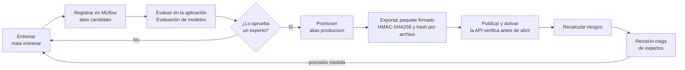

Ningún modelo entra en uso solo: lo aprueba una persona, y la aprobación queda en la auditoría.

### 4.4 Decisiones de arquitectura

| Decisión | Motivo | Consecuencia |
|---|---|---|
| **Entrenamiento y servicio separados**, unidos solo por un paquete firmado | Los datos reales no salen del equipo que entrena. La API nunca abre un `pickle` sin verificar firma, hash y versiones | La demostración pública puede existir sin un solo dato real |
| **El Diccionario es la configuración del dominio** | Qué variables se usan, en qué visita y qué desenlaces se predicen lo deciden los expertos en un Excel, no el código | Agregar una variable o un desenlace no exige programar |
| **Configuración por variables de entorno**, validada al arrancar | La misma imagen sirve en local, demostración y producción | Un secreto de ejemplo fuera del entorno local detiene el arranque |
| **Contrato OpenAPI versionado** del que salen los tipos del frontend | La web y la API no pueden divergir en silencio | Una prueba falla si la API cambia sin regenerar el contrato |
| **Cuatro perfiles con mínimo privilegio** | Quien solo consulta no ve niños uno por uno | Los permisos se aplican en la API, no solo en el menú |
| **Demostración solo con datos simulados** (`MAIA_SOLO_SIMULADO`) | Mostrar la solución sin exponer datos | La API de demostración rechaza cualquier paquete de la base real |

El registro completo de decisiones, con su fecha y su motivo, está en
[`docs/decisiones.md`](6-Codigo-Fuente-Proyecto/docs/decisiones.md).

### 4.5 Atributos de calidad

| Atributo | Cómo se logra |
|---|---|
| **Seguridad** | Contraseñas con Argon2. Token de acceso de 30 minutos y token de refresco en cookie `httpOnly` que rota en cada uso; reusar uno ya rotado cierra todas las sesiones. Cinco intentos de ingreso por minuto. Los secretos guardados desde la web se cifran con Fernet. Los puertos locales escuchan solo en `127.0.0.1` |
| **Privacidad** | El identificador real del paciente nunca se lee: se trabaja con códigos seudonimizados. MLflow guarda solo agregados. La base de origen se abre en solo lectura por dos vías |
| **Integridad de los modelos** | Paquete con firma HMAC-SHA256, hash por archivo y versión del código y de LightGBM, verificados antes de cargar |
| **Trazabilidad** | Auditoría de acciones, historial de ejecuciones, fichas de modelo y MLflow |
| **Mantenibilidad** | 1.324 pruebas automáticas, análisis estático con `ruff` y `tsc`, e integración continua en cada cambio |
| **Portabilidad** | Todo corre en contenedores. Con GPU NVIDIA o en CPU (`SIN_GPU=1`) |
| **Observabilidad** | `/api/salud` para los *healthchecks*, registros por servicio y el detalle técnico de cada ejecución en la web |

---

## 5. Funcionamiento

### 5.1 Requerimientos funcionales

| N.º | La solución debe | Dónde se cumple |
|---|---|---|
| RF1 | Detectar mediciones anómalas y ordenarlas para su revisión | **Mediciones por revisar** · `maia corrida` |
| RF2 | Estimar el riesgo de cada niño en cada visita y explicar por qué | Ficha clínica del niño · **Estimar riesgo** |
| RF3 | Comparar el crecimiento con los estándares de la OMS | **Seguimiento clínico** |
| RF4 | Explorar y comparar grupos de niños | **Comparar grupos de niños** · **Explorar grupos de niños** |
| RF5 | Mostrar qué tan bueno es cada modelo | **Evaluación de modelos**: ficha, detección, calibración, variables, equidad y estabilidad |
| RF6 | Entrenar, aprobar, publicar y activar modelos | **Operación de modelos** · CLI `maia` |
| RF7 | Recoger el criterio de los expertos sin sesgarlo | **Revisión clínica de casos** (ciega) |
| RF8 | Avisar por correo ante riesgo alto | **Notificaciones** |
| RF9 | Controlar quién ve qué | **Usuarios y permisos**, con cuatro perfiles |
| RF10 | Ejecutarse sola cuando llega un corte nuevo | **Programar ejecuciones automáticas** y el servicio `programador` |

### 5.2 La solución en funcionamiento

La instancia desplegada responde sin sesión en su ruta de salud:

```bash
curl https://maia.canbby.com/api/salud
```

```json
{"db": true, "paquete": "2026-11-23-72233b", "entorno": "produccion"}
```

`db` confirma la base de datos, `paquete` es el paquete de modelos activo y `entorno` el modo de ejecución
(respuesta del 26/11/2026).

### 5.3 Prueba de humo local

Con Docker instalado, desde `6-Codigo-Fuente-Proyecto/`:

```bash
make env
```

Edite `.env` con los valores de la [sección 6.4](#64-credenciales-de-ejemplo) y luego:

```bash
docker compose -f docker-compose.app.yml up -d --build
```

```bash
curl http://localhost:8080/api/salud
```

Debe responder `"db": true` y `"entorno": "demo"`. En <http://localhost:8080> aparece el ingreso y, al entrar, una
cohorte de niños simulados (su tamaño lo fija `MAIA_DEMO_SUJETOS`).

### 5.4 Verificación automática

| Conjunto | Pruebas | Qué cubre |
|---|---|---|
| Núcleo | 213 | Contrato SEVARTI, las cinco capas, modelo clínico, crecimiento OMS y Diccionario |
| Común | 256 | Analítica, muestras, filtros, cuotas, notificaciones, cifrado e hiperparámetros |
| Entrenamiento | 81 | La CLI completa: simular, entrenar, registrar, promover, exportar y corrida |
| API | 235 | Rutas con Postgres real, paquete firmado real, correo de prueba y contrato OpenAPI |
| Frontend | 539 | Componentes y pantallas, incluida una guardia del lenguaje clínico |
| **Total** | **1.324** | |

Cantidades del 25/11/2026, según [`docs/decisiones.md`](6-Codigo-Fuente-Proyecto/docs/decisiones.md#pruebas). Se
ejecutan con:

```bash
make verificar-todo
```

La integración continua ([`.github/workflows/codigo.yml`](.github/workflows/codigo.yml)) corre lo mismo en cada
cambio: `ruff` y `pytest` contra un PostgreSQL 16 de servicio, y `vitest` más la compilación del frontend.

---

## 6. Documentación del despliegue

### 6.1 Dependencias

**Sistema**

| Para | Necesita |
|---|---|
| Ver la aplicación o la pila completa | Docker con Compose v2 y `make` |
| Entrenar con GPU | Ubuntu 24.04, controlador NVIDIA y [NVIDIA Container Toolkit](https://docs.nvidia.com/datacenter/cloud-native/container-toolkit/latest/install-guide.html) |
| Entrenar sin GPU o desarrollar | [`uv`](https://docs.astral.sh/uv/) 0.11 o posterior (instala Python 3.13) |
| Desarrollar el frontend | Node 22 |

**Bibliotecas principales**

| Área | Versiones |
|---|---|
| Modelos | LightGBM 4.7.0, pandas 3.0.6, numpy 2.5.4, MLflow 3.17.1 |
| API | FastAPI 0.151.0, Uvicorn 0.54.0, SQLAlchemy 2.1.5, Alembic 1.20.0, psycopg 3.3.6, Pydantic 2 |
| Frontend | React 19.3.1, Vite 8.3.4, TypeScript 5.9.3, Tailwind CSS 4.3.3, Recharts 3.10.1, React Router 7.18.4 |
| Pruebas y calidad | pytest 9, ruff, Vitest 5.0.5, Testing Library |
| Servicios | PostgreSQL 16, MinIO, MLflow 3, Mailpit y nginx |

Las versiones exactas están fijadas en [`uv.lock`](6-Codigo-Fuente-Proyecto/uv.lock) y en
`plataforma/web/package-lock.json`. La API rechaza un paquete de modelos hecho con otra versión de LightGBM.

### 6.2 Entornos de ejecución

| Entorno | `MAIA_ENTORNO` | Dónde corre | Datos | Para qué |
|---|---|---|---|---|
| **Solo la aplicación** | `demo` | Cualquier equipo con Docker | Niños simulados | Recorrer las pantallas en minutos |
| **Local completo** | `local` | Equipo con Docker; GPU opcional | Simulados o la base real | Entrenar y operar de extremo a extremo |
| **Demostración** | `demo` | Railway | Solo simulados | Mostrar la solución sin exponer datos |
| **Producción on-premise** | `produccion` | Servidor propio con GPU | Base real, detrás del ingreso | Operación con la Fundación |

**La instancia desplegada** corre en un servidor propio con GPU, con
[`docker-compose.on-premise.yml`](6-Codigo-Fuente-Proyecto/docker-compose.on-premise.yml) administrado por Coolify:

| Servicio | Dirección | Puerto interno | Qué es | Con qué se ingresa |
|---|---|---|---|---|
| `web` | <https://maia.canbby.com> | 8080 | KMCPred: la aplicación. nginx sirve la interfaz y reenvía `/api` a la API | Cuenta de KMCPred, según el perfil |
| `mlflow` | <https://maia-mlflow.canbby.com> | 5000 | MLflow: experimentos, métricas agregadas y registro de modelos | Usuario de MLflow |
| `minio` | <https://maia-minio.canbby.com> | 9001 | Consola del almacén de objetos: cortes, salidas, paquetes firmados y artefactos de MLflow | Usuario del almacén |

La API, PostgreSQL y el trainer no tienen dirección pública: solo se alcanzan por la red interna.

**MLflow (`maia-mlflow.canbby.com`).** El registro del modelo clínico: cada versión con la huella de su configuración,
su fuente de datos y su alias. La versión 8 es la que está en producción y la 9 espera aprobación.

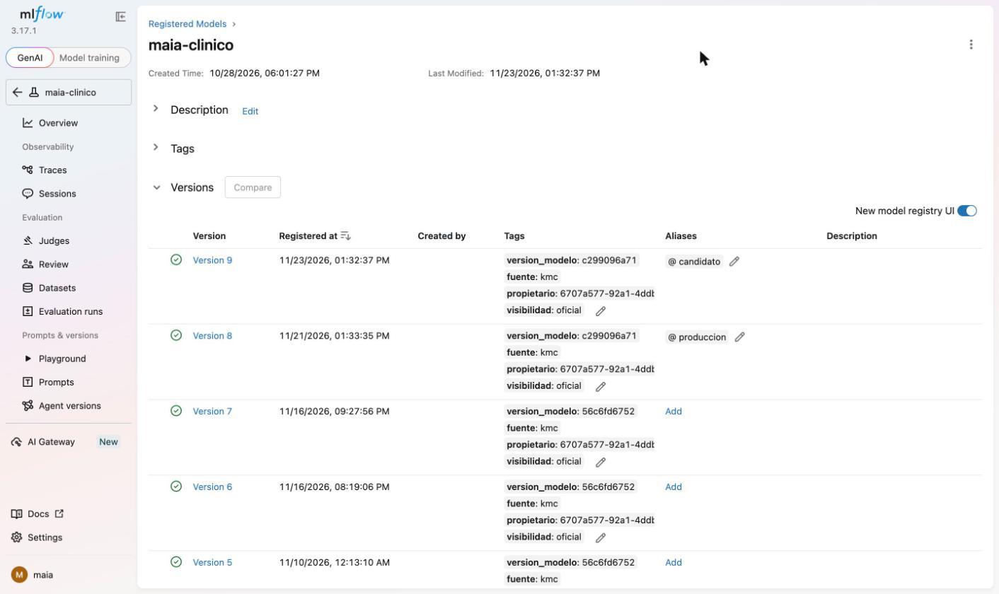

**Almacén de objetos (`maia-minio.canbby.com`).** Los cuatro depósitos de la plataforma: `maia-sevarti` (cortes de
datos), `maia-mlflow` (artefactos de los entrenamientos), `maia-paquetes` (paquetes firmados) y `maia-salidas`
(archivos para la Fundación).

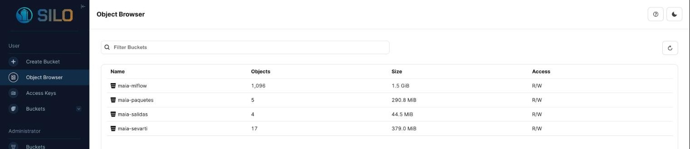

### 6.3 Pasos de despliegue

Todos los comandos se ejecutan desde `6-Codigo-Fuente-Proyecto/`.

#### Ruta A · Solo la aplicación

Base de datos, API y web, sin almacén de objetos, MLflow ni trainer.

| Paso | Comando o acción | Cómo saber que quedó bien |
|---|---|---|
| 1 | `make env` | Existe `.env` |
| 2 | Editar `.env`: `POSTGRES_PASSWORD`, `MAIA_JWT_SECRETO`, `MAIA_PAQUETE_CLAVE`, `MAIA_ADMIN_EMAIL` y `MAIA_ADMIN_CLAVE` | Ninguna de esas cinco dice `cambiar` |
| 3 | `docker compose -f docker-compose.app.yml up -d --build` | `curl http://localhost:8080/api/salud` responde `"db": true` |
| 4 | Abrir <http://localhost:8080> e ingresar con la cuenta de administración | Se ve **Seguimiento clínico** con la cohorte simulada |

Los riesgos quedan vacíos hasta publicar un paquete de modelos (ruta B). Para borrar todo:
`docker compose -f docker-compose.app.yml down -v`.

#### Ruta B · Pila completa con datos simulados

Entrena los dos modelos y recorre el ciclo completo, sin acceso a la base real.

| Paso | Comando o acción | Cómo saber que quedó bien |
|---|---|---|
| 1 | `make env` y editar `.env` ([sección 7.2](#72-variables-de-entorno)) | `grep cambiar .env` no muestra nada |
| 2 | Definir `MINIO_IMAGEN` y `MC_IMAGEN` en `.env` | Ver la nota de abajo |
| 3 | `make arrancar` | `make estado`: todo «healthy» o «running» |
| 4 | `make verificar-gpu` (solo con GPU) | La primera línea dice `cuda` |
| 5 | `make demo-entrenar` | Dos modelos nuevos en MLflow con alias `candidato` |
| 6 | `make demo-exportar` | Un paquete firmado en el almacén |
| 7 | `make demo-publicar` | En **Operación de modelos › Modelos disponibles** hay un paquete `simulado` activo |
| 8 | En la web: **Operación de modelos › Recalcular riesgos › Iniciar recálculo de riesgos** | El resumen, el listado de niños y las colas de revisión tienen datos |

> **Imágenes del almacén de objetos.** `minio/minio` y `minio/mc` dejaron de publicarse en Docker Hub. Antes del
> primer arranque defina `MINIO_IMAGEN` y `MC_IMAGEN` con una fuente que su equipo apruebe; la instancia desplegada
> usa la bifurcación comunitaria de Pigsty (`pgsty/minio` y `pgsty/mc`).

**Sin GPU NVIDIA** (por ejemplo, macOS), la CLI corre en el equipo, en CPU, contra los servicios del compose:

```bash
uv sync --all-packages
```

```bash
make arrancar
```

```bash
make demo-entrenar SIN_GPU=1 && make demo-exportar SIN_GPU=1 && make demo-publicar SIN_GPU=1
```

Direcciones locales:

| Dirección | Qué es |
|---|---|
| <http://localhost:8080> | La aplicación |
| <http://localhost:8080/api/docs> | Documentación interactiva de la API |
| <http://localhost:5000> | MLflow |
| <http://localhost:9001> | Consola del almacén de objetos |
| <http://localhost:8025> | Mailpit: los correos que envía la aplicación |

#### Ruta C · Operación con la base real

| Paso | Comando o acción |
|---|---|
| 1 | Completar la ruta B hasta el paso 4 |
| 2 | Definir `KMC_HOST` y `KMC_USUARIO` en `.env`. La clave va solo en la terminal (`export KMC_PW='...'`) o en el llavero del sistema |
| 3 | `make corrida`: extrae, entrena, revisa los datos y calcula los riesgos |
| 4 | Revisar los modelos nuevos en **Operación de modelos › Entrenar y aprobar modelos** y aprobar los que entran en uso |
| 5 | Para que corra sola: guardar la conexión en **Configuración › Base de datos** (la clave queda cifrada; requiere `MAIA_CIFRADO_CLAVE`), crear el horario en **Programar ejecuciones automáticas** y encender `make programador` |

Para estrenar un modelo sin mostrar sus riesgos ni enviar correos: `make corrida-silencio`.

#### Ruta D · Demostración en Railway

Railway aloja solo la web, la API y un PostgreSQL con niños simulados. Resumen de
[`infra/railway/README.md`](6-Codigo-Fuente-Proyecto/infra/railway/README.md):

| Paso | Comando o acción |
|---|---|
| 1 | `railway login` y `railway init --name maia-demo` |
| 2 | `railway add --database postgres`, `railway add --service api` y `railway add --service web` |
| 3 | Variables de `api`: `MAIA_ENTORNO=demo`, `MAIA_SOLO_SIMULADO=true`, secretos nuevos y la **misma** `MAIA_PAQUETE_CLAVE` del equipo local |
| 4 | `railway volume add --service api --mount-path /datos/paquetes` |
| 5 | Variables de `web`: `MAIA_ENTORNO=demo` y `API_INTERNA` con el dominio privado de la API |
| 6 | `railway domain --service web` |
| 7 | `make railway-api` y `make railway-web` |
| 8 | Publicar el paquete simulado: `maia publicar --url https://<dominio-web> --fuente simulado` |
| 9 | Comprobar `https://<dominio-web>/api/salud`: `"db": true` y `"entorno": "demo"` |

#### Ruta E · Producción on-premise con GPU

Todo el sistema en un servidor propio, con un orquestador de Docker Compose. Es la forma en que está desplegada
<https://maia.canbby.com>. Resumen de
[`infra/on-premise/README.md`](6-Codigo-Fuente-Proyecto/infra/on-premise/README.md):

| Paso | Acción |
|---|---|
| 1 | Servidor con controlador NVIDIA y NVIDIA Container Toolkit. Unos 30 GB libres y 8 GB de RAM o más |
| 2 | Crear el recurso desde el repositorio: *Build Pack* Docker Compose, directorio base `/6-Codigo-Fuente-Proyecto` y archivo `/docker-compose.on-premise.yml` |
| 3 | Asignar el dominio al servicio `web`; el proxy emite el certificado |
| 4 | Revisar las variables de entorno y definir el modo: operación real (`MAIA_ENTORNO=produccion`) o demostración |
| 5 | Desplegar y comprobar `/api/salud` |

### 6.4 Credenciales de ejemplo

La aplicación **no trae usuarios ni contraseñas fijos**. La cuenta de administración se crea en el primer arranque
con lo que cada instalación define en `.env`, y desde ella se crean las demás. Las cuentas de la instancia desplegada
usan datos protegidos por el acuerdo de confidencialidad y se entregan solo a las personas autorizadas.

Para una instalación local de prueba sirven estos valores. Son **de ejemplo**: no los use en un servidor.

| Variable de `.env` | Valor de ejemplo | Nota |
|---|---|---|
| `MAIA_ADMIN_EMAIL` | `admin@ejemplo.org` | Usuario de la aplicación |
| `MAIA_ADMIN_CLAVE` | `Ejemplo-Local-2026` | 12 caracteres o más |
| `POSTGRES_PASSWORD` | `ejemplolocal2026` | Solo letras y números; la misma dentro de `DATABASE_URL` |
| `MAIA_JWT_SECRETO` | salida de `openssl rand -base64 48` | Firma las sesiones |
| `MAIA_PAQUETE_CLAVE` | salida de `openssl rand -base64 32` | Firma los paquetes de modelos |
| `MLFLOW_TRACKING_USERNAME` / `MLFLOW_TRACKING_PASSWORD` | `admin` / `ejemplo-mlflow-2026` | Ingreso a MLflow (ruta B) |
| `MINIO_ROOT_USER` / `MINIO_ROOT_PASSWORD` | `maia` / `ejemplo-minio-2026` | Ingreso a la consola del almacén (ruta B) |

Con la cuenta de administración se crea, en **Administración › Usuarios y permisos**, una cuenta por perfil:

| Perfil | Usuario de ejemplo | Qué puede hacer |
|---|---|---|
| Administración | `admin@ejemplo.org` | Todo, además de usuarios y notificaciones |
| Experto clínico | `expertoclinico@ejemplo.org` | Seguimiento clínico, listado y ficha de cada niño, revisión clínica de casos y estimar riesgo |
| Experto en datos | `expertoendatos@ejemplo.org` | Datos y modelos: mediciones por revisar, guía de variables, entrenar y aprobar modelos y configuración. No ve niños uno por uno |
| Consulta | `consulta@ejemplo.org` | Cifras de grupo: seguimiento clínico, comparar grupos, evaluación de modelos y resumen. No ve niños uno por uno |

La clave de la base de la Fundación (`KMC_PW`) nunca va en un archivo ni en una imagen.

### 6.5 Ejemplos de uso

**1. Estimar el riesgo de un niño desde la aplicación.** En **Estimar riesgo › Estimación individual**, pulse
**Cargar un niño de ejemplo** y luego **Estimar riesgo**. Aparece el riesgo de cada desenlace visita por visita, su
nivel frente a los demás niños y lo que más pesó.

**2. Lo mismo por la API.**

```bash
BASE=http://localhost:8080
```

```bash
TOKEN=$(curl -s -X POST $BASE/api/auth/login -H 'Content-Type: application/json' \
  -d '{"email":"admin@ejemplo.org","clave":"Ejemplo-Local-2026"}' \
  | python3 -c 'import sys,json; print(json.load(sys.stdin)["acceso"])')
```

```bash
curl -s -H "Authorization: Bearer $TOKEN" $BASE/api/inferencia/ejemplo \
  | python3 -c 'import sys,json; d=json.load(sys.stdin); d.pop("nota",None); print(json.dumps(d))' > ejemplo.json
```

```bash
curl -s -X POST $BASE/api/inferencia -H "Authorization: Bearer $TOKEN" \
  -H 'Content-Type: application/json' -d @ejemplo.json
```

La respuesta trae `riesgos` (con sus `motivos`), `alertas_dato`, `crecimiento` y la `historia` del riesgo por
visita. El contrato completo está en `/api/docs`.

**3. Corrida semestral con la base real.**

```bash
export KMC_PW='...'
```

```bash
make corrida
```

**4. Entrenar con un corte y una cohorte específicos.**

```bash
make corrida FECHA_CORTE=2026-06-30 ANIO_DESDE=2015
```

**5. Un detector más exigente.** Cambie `alpha` en la web, o con `{"alpha": 0.005}` en un archivo `config.json`:

```bash
maia entrenar anomalias --config config.json
```

`maia` es la CLI del contenedor `trainer`; en un equipo sin GPU se invoca con `uv run maia`.

**6. Leer los cuadernos sin ejecutar nada.** Abra en el navegador `1-Notebooks/modelo_anomalias.html` o
`1-Notebooks/alertas_clinicas.html`.

**7. Compilar el informe.**

```bash
cd 5-Informe-final-latex && latexmk -pdf articulo.tex
```

Órdenes de la CLI `maia`:

| Orden | Qué hace |
|---|---|
| `extraer` | Trae un corte de la base de origen y lo guarda en Parquet |
| `simular` | Genera una cohorte simulada |
| `entrenar anomalias` / `entrenar clinico` | Valida, entrena y registra en MLflow |
| `promover` | Mueve el alias `produccion` a una versión |
| `exportar` | Arma y firma el paquete de modelos |
| `publicar` | Sube el paquete a una API y lo activa |
| `corrida` | Extrae, revisa los datos y calcula los riesgos |
| `programador` | Ejecuta lo que se programa o se pide en la web |
| `verificar-gpu` | Comprueba que LightGBM entrena en la GPU |

---

## 7. Parametrización

### 7.1 Niveles de configuración

Nada se ajusta tocando código. Hay cinco niveles, cada uno con su dueño:

| Nivel | Qué se ajusta | Dónde | Quién | Cuándo aplica |
|---|---|---|---|---|
| **1. Infraestructura y secretos** | Conexiones, claves, entorno y dispositivo de entrenamiento | `.env`, o variables del servicio en Railway y en el orquestador | Equipo técnico | Al arrancar |
| **2. Ejecución** | GPU o CPU, corte, cohorte y versión del paquete | Variables de `make` y opciones de la CLI | Quien opera | En cada ejecución |
| **3. Modelos** | Hiperparámetros de los dos modelos | Web: **Configuración › Parámetros de entrenamiento**, o `--config archivo.json` | Experto en datos | En el siguiente entrenamiento |
| **4. Dominio clínico** | Variables, visitas, desenlaces y umbrales de crecimiento | El Diccionario (`diccionario.xlsx`), también desde **Guía de variables y unidades** | Expertos | En la siguiente corrida |
| **5. Operación** | Conexión a la base de origen, horarios, correo y reglas de alerta | Web: **Configuración** y **Notificaciones** | Administración | De inmediato |

**Una sola fuente.** Todas las variables de entorno se declaran, con su tipo y su valor por defecto, en
[`maia_comun/config.py`](6-Codigo-Fuente-Proyecto/plataforma/comun/maia_comun/config.py). La plantilla comentada es
[`.env.example`](6-Codigo-Fuente-Proyecto/.env.example).

**Precedencia.** Variable del entorno, después `.env`, después el valor por defecto.

**Falla al arrancar, no en producción.** Fuera de `MAIA_ENTORNO=local`, la API no arranca si `MAIA_JWT_SECRETO`,
`MAIA_PAQUETE_CLAVE` o `MAIA_ADMIN_CLAVE` conservan el valor de ejemplo o tienen menos de 12 caracteres. Los archivos
de `docker compose` tampoco arrancan si falta una clave, y dicen cuál.

### 7.2 Variables de entorno

**Comunes**

| Variable | Por defecto | Qué controla |
|---|---|---|
| `MAIA_ENTORNO` | `local` | Modo de ejecución: `local`, `demo`, `prueba` o `produccion` |
| `DATABASE_URL` | — | Base de la aplicación |
| `MAIA_RAIZ` | `/datos` | Carpeta de trabajo del núcleo dentro del contenedor |
| `MAIA_PAQUETE_CLAVE` | — (obligatoria) | Secreto con que se firman y verifican los paquetes. La misma donde se firma y donde se verifica |
| `MAIA_CIFRADO_CLAVE` | vacía | 32 caracteres o más. Cifra las claves guardadas desde la web; vacía, la web no guarda claves |
| `MAIA_ZONA_HORARIA` | `America/Bogota` | Zona de las ejecuciones programadas |

**API**

| Variable | Por defecto | Qué controla |
|---|---|---|
| `MAIA_JWT_SECRETO` | — (obligatoria) | Firma de los tokens de sesión |
| `MAIA_JWT_MINUTOS` | `30` | Vida del token de acceso |
| `MAIA_REFRESCO_DIAS` | `7` | Vida de la sesión |
| `MAIA_ADMIN_EMAIL`, `MAIA_ADMIN_CLAVE` | — (obligatorias) | Cuenta de administración que se crea con la base vacía |
| `MAIA_SOLO_SIMULADO` | `false` | Con `true`, la API rechaza paquetes de la base real |
| `MAIA_DEMO_SUJETOS` | `3000` | Tamaño de la cohorte simulada del entorno `demo` |
| `MAIA_DIR_PAQUETES` | `/datos/paquetes` | Dónde se guardan los paquetes activados |
| `MAIA_URL_PUBLICA` | `http://localhost:8080` | Dirección que usan los enlaces de los correos |
| `MAIA_CORS_ORIGENES` | `http://localhost:5173` | Orígenes permitidos al desarrollar el frontend |

**Entrenamiento y servicios de apoyo**

| Variable | Por defecto | Qué controla |
|---|---|---|
| `MAIA_LGBM_DEVICE` | `cuda` en la plantilla; `cpu` si no se define | Dispositivo de entrenamiento de LightGBM |
| `POSTGRES_PASSWORD` | — (obligatoria) | Clave de PostgreSQL; la misma dentro de `DATABASE_URL` |
| `MLFLOW_TRACKING_URI` | `http://mlflow:5000` | Servidor de MLflow |
| `MLFLOW_TRACKING_USERNAME`, `MLFLOW_TRACKING_PASSWORD` | — | Administrador de MLflow; lo usan el trainer, el programador y la API |
| `MLFLOW_DB_PASSWORD`, `MLFLOW_FLASK_SERVER_SECRET_KEY` | — | Base y sesiones de MLflow |
| `MLFLOW_URL_PUBLICA` | `http://localhost:5000` | Enlace a MLflow que muestra la web |
| `MINIO_URL` | `http://minio:9000` | Almacén de objetos |
| `MINIO_ROOT_USER`, `MINIO_ROOT_PASSWORD` | `maia`, — | Administrador del almacén |
| `MINIO_ACCESS_KEY`, `MINIO_SECRET_KEY` | `maia-servicio`, — | Usuario de servicio de la plataforma |
| `MLFLOW_MINIO_ACCESS_KEY`, `MLFLOW_MINIO_SECRET_KEY` | `maia-mlflow`, — | Usuario de servicio de MLflow |
| `MINIO_IMAGEN`, `MC_IMAGEN` | etiquetas originales | Imágenes del almacén y de su cliente |

**Base de origen de la Fundación** (también se guardan desde la web, cifradas)

| Variable | Por defecto | Qué controla |
|---|---|---|
| `KMC_HOST`, `KMC_USUARIO` | — | Servidor y usuario de solo lectura; los entrega el Observatorio |
| `KMC_PORT`, `KMC_DB`, `KMC_ESQUEMA` | `5432`, `postgres`, `consumo` | Conexión |
| `KMC_SSLMODE` | `require` | `disable` solo para un PostgreSQL de prueba local |
| `KMC_TIMEOUT` | `20` | Segundos de espera al conectar |
| `KMC_PW` | — | **Nunca en `.env`.** En la terminal, en el llavero del sistema o cifrada desde la web |

**Variables de ejecución (`make`)**

| Variable | Ejemplo | Qué controla |
|---|---|---|
| `SIN_GPU` | `make demo-entrenar SIN_GPU=1` | Corre la CLI en el equipo, en CPU |
| `VERSION` | `make demo-publicar VERSION=...` | Publica un paquete distinto del último |
| `FECHA_CORTE` | `make corrida FECHA_CORTE=2026-06-30` | Lo que se sabía en esa fecha |
| `ANIO_DESDE`, `ANIO_HASTA` | `make corrida ANIO_DESDE=2015` | Años de nacimiento incluidos |
| `DESDE_VISITA`, `HASTA_VISITA` | `make corrida DESDE_VISITA=2025-01-01` | Ventana de visitas |
| `WEB_PUERTO` | `WEB_PUERTO=8081 docker compose -f docker-compose.app.yml up -d` | Puerto de la aplicación en la ruta A |

Las combinaciones imposibles (por ejemplo, un año inicial posterior al final) se rechazan antes de conectar. El
detalle está en [`docs/extraccion.md`](6-Codigo-Fuente-Proyecto/docs/extraccion.md).

### 7.3 Hiperparámetros de los modelos

Se ajustan en la web, en **Datos y modelos › Configuración › Parámetros de entrenamiento**. Cada campo muestra el
valor por defecto y sus límites; los valores fuera de rango se rechazan. Aplican al siguiente entrenamiento, quedan
en la auditoría y MLflow registra los que se usaron.

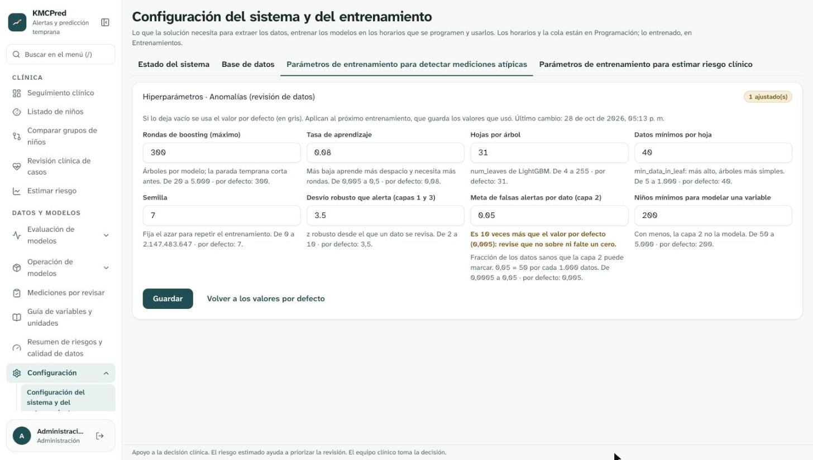

En la captura, `alpha` aparece como ajustado: la instancia desplegada lo subió desde esta pantalla, y la aplicación
avisa cuánto se aleja del valor por defecto.

Valores con que se entrenaron los modelos publicados, según sus fichas:

| Parámetro | Anomalías | Riesgo clínico | Límites |
|---|---|---|---|
| Rondas de boosting (máximo) | 300 | 600 | 20 a 5.000 |
| Tasa de aprendizaje | 0,08 | 0,05 | 0,005 a 0,5 |
| Hojas por árbol | 31 | 31 | 4 a 255 |
| Datos mínimos por hoja | 40 | 50 | 5 a 1.000 |
| Semilla | 7 | 11 | — |
| Desvío robusto que alerta (`z_alerta`) | 3,5 | — | 2 a 10 |
| Meta de falsas alertas por dato (`alpha`) | 0,05 | — | 0,0005 a 0,05 |
| Niños mínimos para modelar una variable | 200 | — | 50 a 5.000 |
| Casos mínimos para modelar un desenlace | — | 30 | 10 a 1.000 |

La lista y sus límites viven en
[`maia_comun/hiperparametros.py`](6-Codigo-Fuente-Proyecto/plataforma/comun/maia_comun/hiperparametros.py). Por línea
de comandos se pasan con `--config archivo.json`.

### 7.4 El Diccionario: la configuración del dominio

`diccionario.xlsx` decide qué aprende el sistema, sin programar:

| Hoja | Qué configura |
|---|---|
| **Variables** | Estado de cada variable («Lista», «Por clasificar» o «No usar»), tipo, unidad, visita y rango esperado |
| **Visitas** | La ventana de edad de cada control |
| **Episodios** y **Quiebres** | Estancias, y cambios conocidos en la forma de registrar |
| **Desenlaces** | Qué se predice, en qué visita, cómo se lee y contra qué regla simple se compara. Estado «En uso», «En prueba» o «No usar» |
| **Crecimiento** y **Curva OMS** | Indicadores, puntaje z bajo el cual es bajo (−2) y caída entre visitas que alerta (1) |

Una variable nueva de la base entra como «Por clasificar» y no se usa hasta que un experto la revisa. Un error en el
archivo detiene la corrida con la hoja, la fila y el valor.

### 7.5 Configuración desde la web

| Pantalla | Qué se configura |
|---|---|
| **Configuración › Estado del sistema** | Lista de comprobación: llave de cifrado, conexión, horario y modelos aprobados |
| **Configuración › Base de datos** | Conexión a la base de origen. La clave se guarda cifrada y no se vuelve a mostrar. **Probar conexión** valida sin guardar |
| **Configuración › Programar ejecuciones automáticas** | Frecuencia (semestre, trimestre, mes, semana, día o expresión `cron`), filtros de la extracción, modo silencio |
| **Notificaciones › Configuración del correo saliente** | Servidor de correo, con correo de prueba |
| **Notificaciones › Reglas y envíos de alertas por correo** | A quién se avisa y ante qué riesgo |

---

## 8. Usabilidad y presentación de la información

### 8.1 Criterios de diseño

La aplicación la usa sobre todo el equipo clínico, no analistas de datos. Cada decisión de la interfaz parte de eso:

| Criterio | Cómo se ve en la aplicación |
|---|---|
| **Lenguaje de quien la usa** | El riesgo de un niño se dice en frecuencias, «N de 10 niños tienen menos riesgo», y no como un percentil. Una prueba automática (`lenguaje.test.tsx`) vigila que la jerga no vuelva a esas pantallas |
| **Cada gráfica se explica sola** | Bajo el título hay una frase fija que dice qué muestra y cómo leerla |
| **El riesgo siempre con su porqué** | Junto a cada riesgo, **Lo que más pesó**, y cuánto subió o bajó desde la visita anterior |
| **Nunca un número sin contexto** | Cada modelo muestra su estado (**En uso** o **En prueba**), sus datos, su fecha y su versión |
| **Semáforo antes que tabla** | La ficha de cada modelo resume rendimiento, calibración, equidad, estabilidad y población en verde, ocre o coral |
| **El dato se puede llevar** | Cada gráfica se descarga en PNG y cada tabla de agregados en CSV |
| **Accesibilidad** | **Ver como tabla** para quien no distingue los colores, recorrido de las gráficas con el teclado y anuncios para lectores de pantalla |
| **Ayuda en el lugar** | Los términos técnicos tienen un «¿qué significa?» al pasar el cursor, y un glosario |
| **Acciones seguras** | Cada confirmación dice qué va a pasar, a quién afecta y si se puede deshacer |
| **Cada perfil ve lo suyo** | El menú muestra solo lo que el perfil puede usar, con un buscador (`/` o `Ctrl+K`) |
| **Sirve en el teléfono** | El menú se pliega y las pantallas pasan a una sola columna |
| **Honestidad** | En cada página: «Apoyo a la decisión clínica. El equipo clínico toma la decisión.» |

### 8.2 Navegación por perfil

| Sección del menú | Pantallas | Consulta | Experto clínico | Experto en datos | Administración |
|---|---|:-:|:-:|:-:|:-:|
| **Clínica** | Seguimiento clínico · Comparar grupos de niños | ✓ | ✓ | ✓ | ✓ |
| | Listado de niños y ficha clínica · Revisión clínica de casos · Estimar riesgo | | ✓ | | ✓ |
| **Datos y modelos** | Evaluación de modelos · Resumen de riesgos y calidad de datos | ✓ | | ✓ | ✓ |
| | Operación de modelos · Mediciones por revisar · Guía de variables y unidades · Configuración | | | ✓ | ✓ |
| **Notificaciones** | Configuración del correo saliente · Reglas y envíos de alertas | | | | ✓ |
| **Administración** | Usuarios y permisos | | | | ✓ |

### 8.3 Recorrido visual

**Ingreso.** La primera pantalla dice qué hace el sistema y que apoya la decisión clínica sin sustituirla.

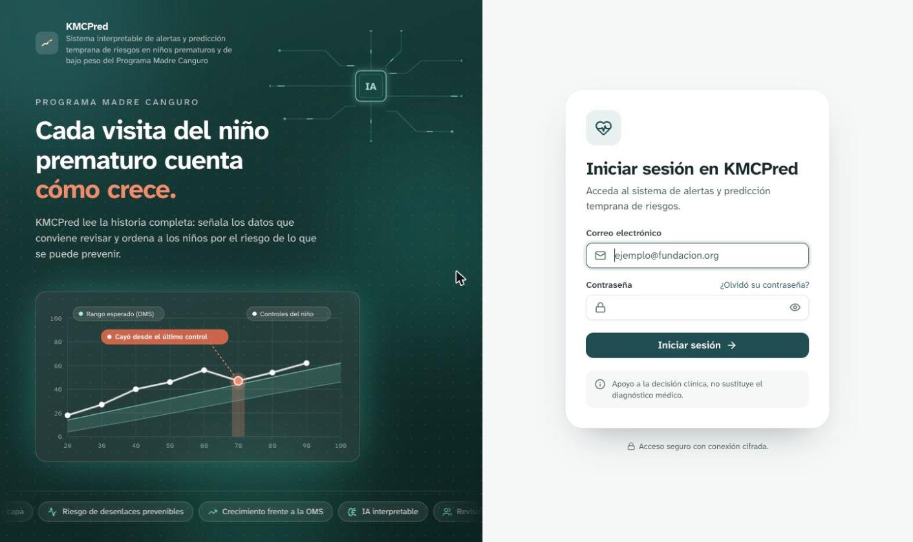

**Seguimiento clínico, la pantalla de inicio.** Arriba, el grupo activo y el desenlace. A la izquierda, lo que pasó
a los 12 meses y el crecimiento por visita en caja y bigotes, con su guía «Cómo leerla». A la derecha, cuántos niños
están en alerta en cada visita y a quién mirar primero.

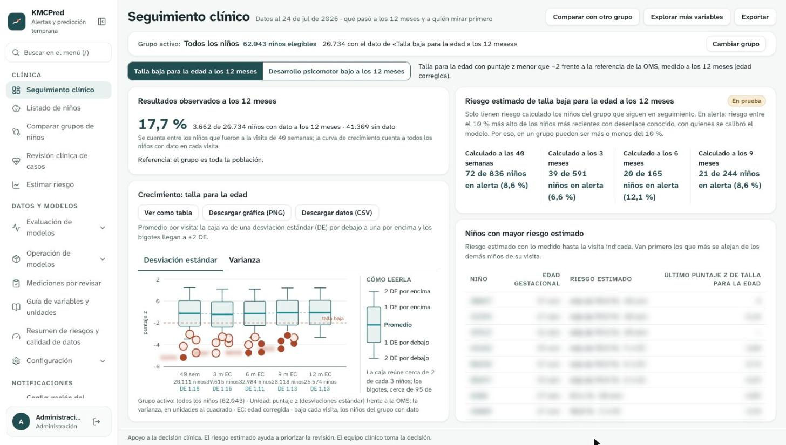

**El riesgo de un niño, visita por visita.** Para cada visita: el riesgo estimado, cuántos niños tienen menos riesgo,
cuánto cambió desde el control anterior y los tres datos que más pesaron. La etiqueta **En prueba** y la línea
«Cómo se calculó» dejan a la vista el estado y la versión del modelo.

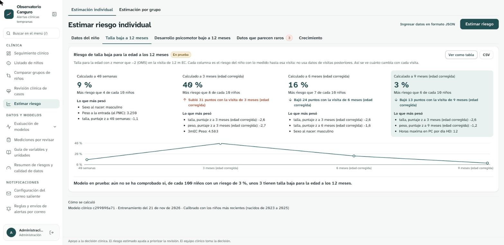

**La ficha de un modelo.** Cada métrica con una frase que la explica, la comparación con la regla simple y un
semáforo por área.

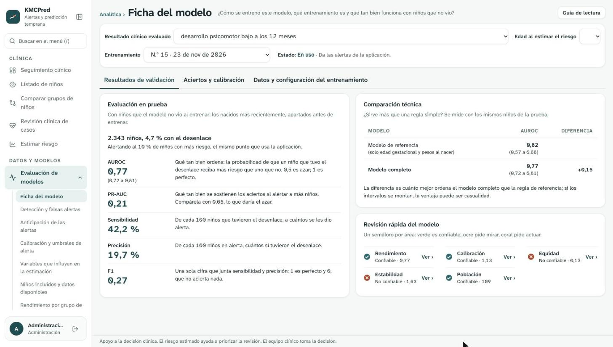

**¿Se le puede creer al porcentaje?** Riesgo estimado frente a lo observado en diez grupos de niños, con la tabla al
lado y los términos técnicos subrayados para ver su explicación.

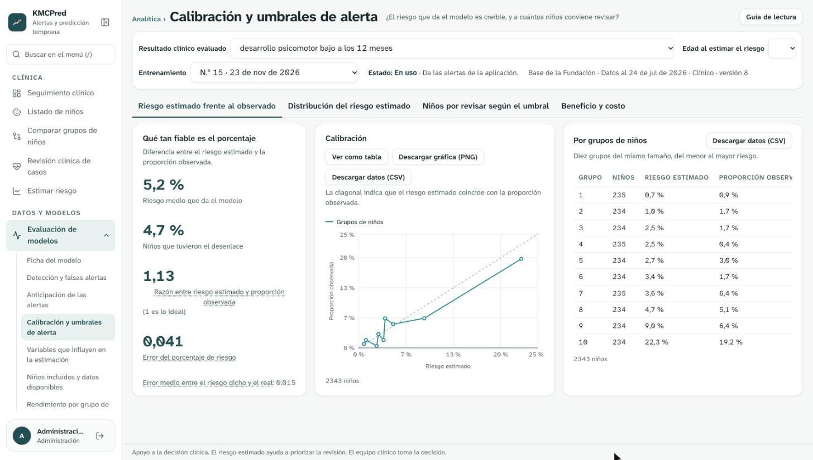

**Operar los modelos sin línea de comandos.** Cada entrenamiento con sus hiperparámetros y su resultado. Una persona
elige la versión y la pone en uso; el alias `produccion` marca la que está activa.

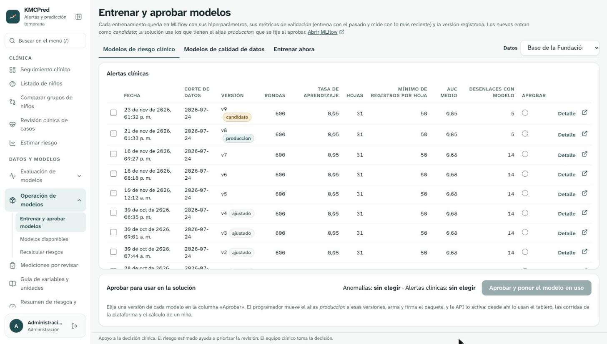

Las capturas son de la instancia desplegada, del 26/11/2026. En **Seguimiento clínico** se difuminaron los niños
individuales. La captura de la estimación individual es la del informe final, con un niño simulado; en ella la marca
del menú todavía dice «Observatorio Canguro», el nombre anterior de la aplicación.

### 8.4 Manuales

* [Manual de uso por perfil](6-Codigo-Fuente-Proyecto/docs/manual_usuario.md), con glosario y preguntas frecuentes.
* Guía para definir una muestra de niños, en `6-Codigo-Fuente-Proyecto/docs/guia-muestras/`.

---

## 9. Operación y mantenimiento

| Tarea | Cómo |
|---|---|
| Corrida ante un corte nuevo | Programada en la web con `make programador`, o `make corrida-si-hay-corte-nuevo` desde `cron` |
| Ver el estado y los registros | `make estado` y `make registros` |
| Respaldar | `make respaldo`: PostgreSQL y el almacén de objetos en `respaldos/<fecha>/` |
| Actualizar el código | `make arrancar` reconstruye; en Railway, `make railway-api` y `make railway-web` |
| Cambiar el esquema de la base | Una migración nueva de Alembic; la API la aplica al arrancar |
| Detener | `make detener`: los datos quedan en los volúmenes |

**Problemas frecuentes**

| Síntoma | Solución |
|---|---|
| La API no arranca: «Defina valores propios» | Cambie `MAIA_JWT_SECRETO`, `MAIA_PAQUETE_CLAVE` y `MAIA_ADMIN_CLAVE` por valores de 12 caracteres o más |
| «La firma no coincide» al subir un paquete | Use la misma `MAIA_PAQUETE_CLAVE` donde se firma y donde se verifica |
| «No hay un paquete de modelos activo» | `make demo-publicar`, o **Operación de modelos › Modelos disponibles › Activar** |
| El trainer no arranca en un equipo sin NVIDIA | Agregue `SIN_GPU=1` |
| La web responde 502 en `/api` | La API no está sana: `make registros` |

La lista completa está en
[`6-Codigo-Fuente-Proyecto/README.md`](6-Codigo-Fuente-Proyecto/README.md#problemas-frecuentes).

---

## 10. Límites y uso responsable

* **Evaluación retrospectiva.** Los resultados salen de datos históricos. Falta la validación clínica prospectiva.
* **Los motivos no son causas.** TreeSHAP explica el cálculo del modelo, no por qué un niño tendrá el desenlace.
* **Errores sintéticos.** El 83,6 % mide errores inyectados; cuántas alertas son errores reales lo dirá la revisión
  de los expertos.
* **Definiciones propias.** «Desarrollo psicomotor bajo» es el 10 % inferior de los niños de entrenamiento: una
  definición del proyecto, no un diagnóstico.
* **Seguimiento incompleto.** No todos los niños llegan a los 12 meses; cada modelo se evalúa solo con quienes
  tienen el desenlace observado.
* **Una sola institución.** Los modelos no se han probado en otra población.
* **Decide el equipo clínico.** El riesgo estimado ayuda a priorizar la revisión; la decisión es de las personas.

---

## 11. Documentación relacionada

| Documento | Para qué |
|---|---|
| [`6-Codigo-Fuente-Proyecto/README.md`](6-Codigo-Fuente-Proyecto/README.md) | Guía técnica completa de la plataforma |
| [`docs/manual_usuario.md`](6-Codigo-Fuente-Proyecto/docs/manual_usuario.md) | Manual de uso por perfil |
| [`docs/decisiones.md`](6-Codigo-Fuente-Proyecto/docs/decisiones.md) | Decisiones técnicas, versiones y pruebas |
| [`docs/extraccion.md`](6-Codigo-Fuente-Proyecto/docs/extraccion.md) | Extracción parametrizada de la base de origen |
| [`infra/railway/README.md`](6-Codigo-Fuente-Proyecto/infra/railway/README.md) | Demostración en Railway |
| [`infra/on-premise/README.md`](6-Codigo-Fuente-Proyecto/infra/on-premise/README.md) | Producción on-premise con GPU |
| [`4-Insumos-Proyecto/insumo-datos/README.md`](4-Insumos-Proyecto/insumo-datos/README.md) | El núcleo de datos y modelos, y el Diccionario |
| [`5-Informe-final-latex/articulo.pdf`](5-Informe-final-latex/articulo.pdf) | Informe final |
| [Fundación Canguro](https://fundacioncanguro.co/) | Sitio institucional |
| [Estándares de crecimiento de la OMS](https://www.who.int/tools/child-growth-standards) | Referencia de crecimiento |
