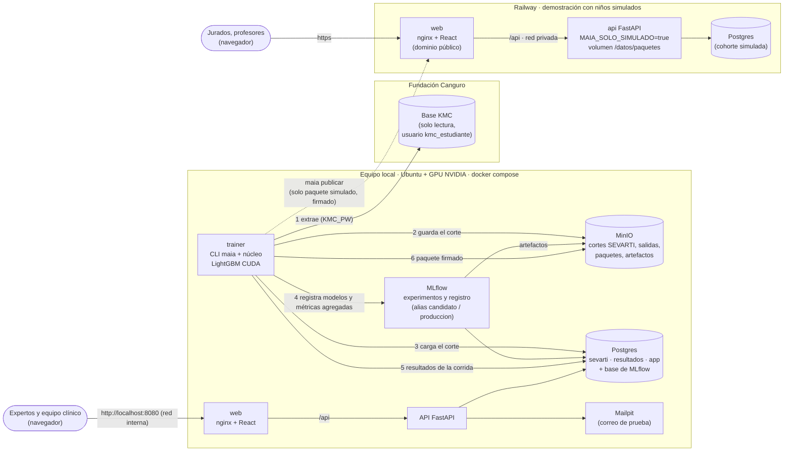
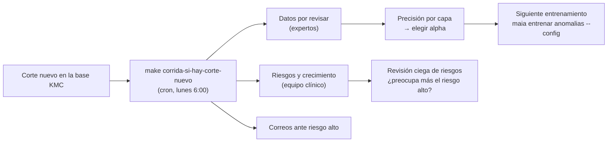

# Observatorio Canguro · MAIA

Alertas clínicas tempranas con IA interpretable en niños prematuros y de bajo peso. Proyecto de grado de la Maestría
en Inteligencia Artificial (Universidad de los Andes) con la Fundación Canguro.

Dos modelos sobre la base del Programa Madre Canguro:

* **Anomalías**: encuentra los datos raros de cada niño (capas de valor, contexto, trayectoria y grupo) y arma la cola
  que revisan los expertos.
* **Alertas clínicas**: ordena a los niños por el riesgo de desenlaces que se pueden prevenir, con los motivos que más
  pesaron, y mide el crecimiento contra el estándar de la OMS.

Apoyo a la decisión, no diagnóstico.

**Contenido:** [Arquitectura](#arquitectura) · [Local y Railway](#qué-corre-en-local-y-qué-va-en-railway) ·
[Configuración local](#configuración-local) · [Ejecución local](#ejecución-local) ·
[Despliegue completo](#despliegue-completo-paso-a-paso) · [On-premise con GPU](infra/on-premise/README.md) ·
[Operación](#operación-del-semestre) ·
[Desarrollo](#desarrollo) · [Problemas frecuentes](#problemas-frecuentes)

---

## Arquitectura



Si su visor no dibuja Mermaid (GitHub, GitLab y VS Code sí lo hacen), esta es la misma idea:

```
  Base KMC ──(KMC_PW)──▶ trainer (GPU) ──▶ MinIO ◀── MLflow ──▶ Postgres ◀── API ◀── web ◀── expertos
                              │                                    ▲
                              └──────────── resultados ────────────┘
                              │
                              └── maia publicar (paquete simulado firmado) ──▶ web Railway ──▶ API Railway ──▶ Postgres Railway
```

### Componentes

| Servicio | Qué hace | Imagen / código | Puerto local | Dónde |
|---|---|---|---|---|
| `postgres` | Datos SEVARTI cargados, resultados de las corridas, usuarios y revisiones; base de MLflow | `postgres:16` | 5432 | local |
| `minio` | Cortes de la base (parquet), salidas para la Fundación, paquetes de modelos, artefactos de MLflow | `minio/minio` | 9000 (API), 9001 (consola) | local |
| `minio-init` | Crea los cuatro buckets con versionado y dos usuarios de servicio | `minio/mc` | — | local |
| `mlflow` | Experimentos, métricas agregadas y registro de modelos con alias `candidato` y `produccion` | `infra/docker/mlflow.Dockerfile` | 5000 | local |
| `trainer` | CLI `maia`: extraer, simular, entrenar, exportar, publicar, corrida | `infra/docker/trainer.Dockerfile` (CUDA) | — | local |
| `api` | FastAPI: sesión, tablero, niños, revisión, inferencia, paquetes, corridas, correo | `infra/docker/api.Dockerfile` | 8000 (interno) | local y Railway |
| `web` | React compilado, servido por nginx, que también reenvía `/api` a la API | `infra/docker/web.Dockerfile` | 8080 | local y Railway |
| `mailpit` | Recibe los correos en local para revisarlos | `axllent/mailpit` | 8025 (web), 1025 (SMTP) | local |

### Cómo viajan los modelos

1. El trainer entrena y registra cada modelo en MLflow (alias `candidato`).
2. `maia promover` mueve el alias `produccion` a la versión aprobada.
3. `maia exportar` arma un **paquete firmado**: los dos modelos, el esquema del corte de entrenamiento y un manifiesto
   con hash de cada archivo, versión de LightGBM y del código, firmado con HMAC-SHA256 (`MAIA_PAQUETE_CLAVE`).
4. `maia publicar` sube el paquete a una API (la local o la de Railway) y lo activa.
5. La API verifica firma, hashes y versiones antes de abrir un solo archivo; la de Railway, además, rechaza todo
   paquete que no venga de datos simulados.

---

## Qué corre en local y qué va en Railway

| | Equipo local | Railway |
|---|---|---|
| **Para qué** | El trabajo real: corrida semestral, revisión de los expertos, correos al equipo clínico | Mostrar la solución (jurados, profesores, socialización) sin exponer datos |
| **Datos** | Base real de la Fundación y cohortes simuladas | Solo una cohorte simulada que la API genera al arrancar |
| **Servicios** | Postgres, MinIO, MLflow, trainer (GPU), API, web, Mailpit | Postgres administrado, API y web |
| **Modelos** | Se entrenan aquí (GPU) | Llegan como paquete firmado, entrenado con datos simulados |
| **Secretos** | `.env` (fuera de git) y `KMC_PW` en la terminal o el llavero | Variables de servicio de Railway; **nunca** `KMC_PW` |
| **Correo** | Mailpit, o el SMTP de la Fundación | SMTP opcional |
| **Acceso** | `http://localhost:8080` o la red interna | Dominio `*.up.railway.app` con HTTPS |

Reglas que no se rompen:

* Ningún dato de un niño real sale del equipo local: ni a git, ni a Railway, ni a MLflow (que solo guarda agregados).
* `railway up` no sube datos, modelos, `.env` ni respaldos (`.railwayignore`).
* `MAIA_SOLO_SIMULADO=true` en Railway hace que la API rechace paquetes de la base real.
* `KMC_PW` nunca va en un archivo, una imagen ni en Railway.

---

## Configuración local

### Requisitos

| Equipo | Necesita |
|---|---|
| **Entrenamiento con GPU** (el de producción) | Ubuntu 24.04, controlador NVIDIA, Docker Engine con Compose v2, [NVIDIA Container Toolkit](https://docs.nvidia.com/datacenter/cloud-native/container-toolkit/latest/install-guide.html), `make` |
| **Equipo sin NVIDIA** (p. ej. macOS, para desarrollo o la demostración) | Docker Desktop, `make`, [`uv`](https://docs.astral.sh/uv/) 0.11 |
| **Desarrollo del frontend** | Node 22 |

### 1. Variables de entorno

```bash
cd proyecto-codigo
make env          # crea .env desde .env.example (no sobrescribe uno existente)
```

Edite `.env` y cambie todo lo que dice `cambiar`:

| Variable | Qué poner |
|---|---|
| `POSTGRES_PASSWORD` y la clave dentro de `DATABASE_URL` | La misma clave nueva en los dos lugares |
| `MLFLOW_DB_PASSWORD` | Clave de la base de MLflow (la crea `infra/local/initdb`) |
| `MINIO_ROOT_PASSWORD`, `MINIO_SECRET_KEY`, `MLFLOW_MINIO_SECRET_KEY` | Claves de 8 caracteres o más |
| `MAIA_PAQUETE_CLAVE` | Secreto largo (`openssl rand -base64 32`). **Será la misma en Railway**: con ella se firman y verifican los paquetes |
| `MAIA_JWT_SECRETO` | Secreto largo (`openssl rand -base64 48`) |
| `MAIA_ADMIN_EMAIL`, `MAIA_ADMIN_CLAVE` | La cuenta de administración que se crea al arrancar por primera vez |
| `MAIA_LGBM_DEVICE` | `cuda` en el equipo con GPU, `cpu` en otro |
| `SMTP_*` | Mailpit por defecto; el servidor de la Fundación cuando se quiera enviar de verdad |

Los valores `postgres`, `minio`, `mlflow` y `mailpit` de las URL son los nombres de los servicios dentro del compose;
no los cambie.

### 2. La clave de la base de la Fundación

`KMC_PW` no va en `.env`. Elija una forma:

```bash
export KMC_PW='...'                                        # solo para esta terminal
secret-tool store --label='MAIA KMC' maia kmc_pw            # Ubuntu: queda en el llavero (para cron)
security add-generic-password -s maia -a kmc_pw -w          # macOS: queda en el llavero
```

El `Makefile` la toma de la terminal o, si no está, del llavero.

---

## Ejecución local

### Solo ver la aplicación (base de datos, API y web)

Para recorrer las pantallas sin MinIO, MLflow, trainer ni `.env`:

```bash
docker compose -f docker-compose.app.yml up -d --build    # http://localhost:8080
docker compose -f docker-compose.app.yml down -v          # detiene y borra los datos de prueba
```

Ingreso: `admin@maia.local` / `clave-local-maia`. La API siembra 1.000 niños simulados (`MAIA_DEMO_SUJETOS`). El
tablero y los riesgos quedan vacíos hasta que se publique un paquete de modelos (ver [Probar con datos
simulados](#probar-con-datos-simulados), con la pila completa). Otro puerto: `WEB_PUERTO=8081`.

### Levantar todo

```bash
make arrancar        # construye y levanta postgres, minio, mlflow, mailpit, api y web
make estado          # todos deben aparecer "healthy" o "running"
make verificar-gpu   # solo en el equipo con GPU: debe decir "cuda"
```

La primera vez tarda (descarga imágenes y compila LightGBM con CUDA para el trainer). La API aplica las migraciones y
crea la cuenta de administración al arrancar.

| Dirección | Qué es |
|---|---|
| http://localhost:8080 | La aplicación (ingrese con `MAIA_ADMIN_EMAIL` / `MAIA_ADMIN_CLAVE`) |
| http://localhost:8080/api/docs | Documentación de la API |
| http://localhost:5000 | MLflow |
| http://localhost:9001 | Consola de MinIO (`MINIO_ROOT_USER` / `MINIO_ROOT_PASSWORD`) |
| http://localhost:8025 | Mailpit: los correos que envía la aplicación |

Todos los puertos escuchan solo en `127.0.0.1`. Para dar acceso en la red interna de la Fundación, publique el 8080
con el proxy o firewall que use la red.

### Probar con datos simulados

```bash
make demo-entrenar    # cohorte simulada de 5.000 niños, entrena los dos modelos, los registra en MLflow
make demo-exportar    # arma y firma el paquete simulado
make demo-publicar    # lo sube y lo activa en la web local
```

Luego, en la web: **Administración → Corridas → Ejecutar corrida**. En unos segundos el tablero, la lista de niños y
las colas de revisión tienen datos.

### Con la base real

```bash
make corrida              # extrae, guarda el corte, entrena, revisa, compara con el silencio y calcula riesgos
make corrida-silencio     # igual, pero los riesgos se guardan sin mostrarse ni enviar correos
```

Los Excel para la Fundación quedan en el volumen del trainer (`/datos/salidas`) y en MinIO (`maia-salidas`).

### Sin GPU NVIDIA (macOS u otro equipo)

El contenedor `trainer` pide una GPU NVIDIA. En un equipo sin ella, levante los servicios igual y corra la CLI
directamente en el equipo, en CPU, con `SIN_GPU=1`:

```bash
uv sync                        # una vez: entorno de Python del proyecto
make arrancar
make demo-entrenar SIN_GPU=1
make demo-exportar SIN_GPU=1
make demo-publicar SIN_GPU=1
```

Con `SIN_GPU=1` la CLI lee `.env` y apunta a los servicios del compose en `localhost` (Postgres 5432, MinIO 9000,
MLflow 5000). Lo que escribe el núcleo queda en `nucleo/salidas`, `nucleo/cortes` y `nucleo/paquetes`, que están
fuera de git y de Railway. Entrenar con la base completa en CPU funciona, pero tarda bastante más.

### Detener, respaldar, ver registros

```bash
make detener         # detiene todo; los datos quedan en los volúmenes de Docker
make registros       # últimos registros de la API y la web
make respaldo        # Postgres (maia y mlflow) y MinIO en respaldos/<fecha>/
```

---

## Despliegue completo paso a paso

El orden importa: Railway recibe modelos que se entrenan en el equipo local, así que primero se monta lo local.

### Fase A · Equipo local

| Paso | Comando o acción | Cómo saber que quedó bien |
|---|---|---|
| A1 | Clonar o copiar `proyecto-maia` y entrar a `proyecto-codigo/` | Existe `Makefile` |
| A2 | `make env` y editar `.env` ([Configuración local](#configuración-local)) | No queda ningún `cambiar` (`grep cambiar .env` no muestra nada) |
| A3 | Guardar `KMC_PW` en el llavero | `secret-tool lookup maia kmc_pw` la muestra |
| A4 | `make arrancar` | `make estado`: todo sano; http://localhost:8080 muestra el ingreso |
| A5 | `make verificar-gpu` | Primera línea: `cuda` |
| A6 | Ingresar como administración y crear los usuarios en **Administración → Usuarios** | Los expertos pueden ingresar |
| A7 | `make demo-entrenar && make demo-exportar && make demo-publicar` | En **Modelos** aparece un paquete `simulado` activo |
| A8 | **Corridas → Ejecutar corrida** | El tablero muestra niños, datos por revisar y riesgos |
| A9 | `make corrida` (base real) | Corrida terminada; Excel en `maia-salidas`; tablero con los niños reales |
| A10 | Activar desenlaces en **Notificaciones** y **Enviar prueba** | El correo llega (Mailpit o el buzón real) |
| A11 | Programar la corrida (ver [Operación](#operación-del-semestre)) | `crontab -l` muestra la línea |

> **Alternativa: todo on-premise en un servidor con GPU.** Si el servidor propio tiene GPU NVIDIA, las fases A a D
> se reemplazan por un solo recurso Docker Compose: ver [`infra/on-premise/README.md`](infra/on-premise/README.md).

### Fase B · Railway (una sola vez)

Requisitos: cuenta de Railway y su CLI (`npm i -g @railway/cli`). Todo desde `proyecto-codigo/`. Los comandos
completos, con cada variable, están en [`infra/railway/README.md`](infra/railway/README.md).

| Paso | Comando o acción |
|---|---|
| B1 | `railway login` y `railway init --name maia-demo` |
| B2 | `railway add --database postgres` |
| B3 | `railway add --service api` y `railway add --service web` |
| B4 | Variables de `api`: `RAILWAY_DOCKERFILE_PATH=infra/docker/api.Dockerfile`, `DATABASE_URL=${{Postgres.DATABASE_URL}}`, `PORT=8000`, `RAILWAY_RUN_UID=0`, `MAIA_ENTORNO=demo`, `MAIA_SOLO_SIMULADO=true`, secretos nuevos (`MAIA_JWT_SECRETO`, `MAIA_ADMIN_CLAVE`) y la **misma** `MAIA_PAQUETE_CLAVE` del `.env` local |
| B5 | Volumen de `api`: `railway volume add --service api --mount-path /datos/paquetes` |
| B6 | Variables de `web`: `RAILWAY_DOCKERFILE_PATH=infra/docker/web.Dockerfile`, `MAIA_ENTORNO=demo`, `API_INTERNA=http://${{api.RAILWAY_PRIVATE_DOMAIN}}:8000` |
| B7 | Dominio público: `railway domain --service web` |
| B8 | En el panel, **Settings → Deploy**: healthcheck `/api/salud` (api) y `/config.js` (web); 1 réplica cada uno |

Las variables reemplazan los archivos `railway.json`: Railway dejó de aceptarlos en servicios nuevos (detalle en
`docs/decisiones.md`).

### Fase C · Desplegar el código

```bash
make railway-api      # railway up --service api --detach
make railway-web      # railway up --service web --detach
```

Al arrancar, la API de Railway aplica las migraciones, crea la cuenta de administración y siembra una cohorte
simulada de `MAIA_DEMO_SUJETOS` niños. Compruebe `https://<dominio-web>/api/salud`: `{"db": true, ..., "entorno": "demo"}`.

### Fase D · Publicar los modelos en Railway

Desde el equipo local, con el paquete simulado ya exportado (paso A7):

```bash
read -rsp 'Clave de administración en Railway: ' RCLAVE; echo
docker compose --env-file .env -f infra/local/docker-compose.yml --profile entrenamiento run --rm \
  -e MAIA_ADMIN_EMAIL=<correo de Railway> -e MAIA_ADMIN_CLAVE="$RCLAVE" \
  trainer publicar --url https://<dominio-web> --fuente simulado
unset RCLAVE
```

(Sin GPU: `MAIA_ADMIN_EMAIL=... MAIA_ADMIN_CLAVE="$RCLAVE" uv run maia publicar --url https://<dominio-web> --fuente simulado`.)

### Fase E · Verificar la demostración

1. Ingrese a `https://<dominio-web>` con la cuenta de administración de Railway; arriba debe aparecer el aviso de
   demostración con niños simulados.
2. **Modelos**: el paquete `simulado` aparece activo.
3. **Corridas → Ejecutar corrida**: termina en segundos.
4. **Tablero**, **Niños** y la línea temporal de un niño muestran datos.
5. Cree usuarios de consulta para quienes van a ver la demostración.

### Actualizaciones

| Qué cambió | Qué hacer |
|---|---|
| Código de la API o de la web | `make railway-api` / `make railway-web` (y `make arrancar` en local, que reconstruye) |
| Modelos simulados nuevos | `make demo-entrenar`, `make demo-exportar` y la Fase D; luego una corrida en la web |
| Modelos con datos reales | Solo en local: `make corrida` |
| Núcleo nuevo en `insumo-datos` | `make sincronizar-nucleo` (copia, vuelve a aplicar `nucleo/parches` y corre sus pruebas) |
| Esquema de la base | Migración nueva en `plataforma/comun/maia_comun/alembic/versions`; la API la aplica al arrancar |

---

## Operación del semestre



* **Corrida automática.** Con `KMC_PW` en el llavero, agregue a `crontab -e`:
  `0 6 * * 1 cd /ruta/proyecto-codigo && make corrida-si-hay-corte-nuevo >> respaldos/cron.log 2>&1`
  (corre cada lunes y solo trabaja si la base cambió).
* **Revisión.** Los expertos responden **Datos por revisar** y **Revisión de riesgos**. Al final de **Revisión de
  riesgos**, administración ve qué parte de lo marcado por cada capa era un error y si los niños de riesgo alto
  preocupan más que el resto. Con esa precisión se elige `alpha` para el siguiente entrenamiento
  (`maia entrenar anomalias --config archivo.json`, con `{"alpha": ...}`).
* **Silencio.** Antes de mostrar riesgos de un modelo nuevo, `make corrida-silencio` los guarda sin entregarlos para
  compararlos después.
* **Respaldo.** `make respaldo` después de cada corrida.

---

## Desarrollo

```bash
uv sync                                       # entorno de Python con todo el workspace
make pruebas                                  # pytest (usa el Postgres del compose o MAIA_TEST_DATABASE_URL)
uv run uvicorn maia_api.main:app --reload     # API en http://localhost:8000 (MAIA_ENTORNO=local)
cd plataforma/web && npm ci && npm run dev    # web en http://localhost:5173, con /api hacia localhost:8000
make tipos-web                                # regenera los tipos del frontend si cambia la API
make verificar-todo                           # ruff + pruebas de Python + pruebas y build del frontend
```

### Estructura

```
proyecto-codigo/
├── nucleo/                    copia de insumo-datos (contrato SEVARTI y los dos modelos) + parches/
├── plataforma/
│   ├── comun/                 configuración, base de datos (Alembic), MinIO, paquetes firmados, correo, puntuación
│   ├── entrenamiento/         CLI "maia": extraer, simular, entrenar, registrar, exportar, publicar, corrida
│   ├── api/                   FastAPI: sesión, tablero, niños, revisión, inferencia, modelos, corridas
│   └── web/                   React + Vite + Tailwind
├── infra/
│   ├── local/                 docker-compose del equipo local, inicialización de Postgres y MinIO
│   ├── docker/                Dockerfile de trainer (CUDA), api, web (nginx) y mlflow
│   ├── railway/               guía detallada de la demostración
│   ├── on-premise/            guía del despliegue completo on-premise (docker-compose.on-premise.yml)
│   └── openapi.json           contrato de la API (de él salen los tipos del frontend)
├── docs/decisiones.md         versiones, desvíos del plan y lo que falta verificar
├── docker-compose.app.yml     solo base de datos, API y web, para ver la aplicación
├── docker-compose.on-premise.yml  despliegue completo en un servidor con GPU
├── Makefile                   todas las tareas ("make" muestra la ayuda)
└── uv.lock                    versiones exactas de Python
```

Perfiles de la aplicación: **administración** (todo), **experto clínico** (revisiones y cálculo de un niño) y
**consulta** (tablero y lista de niños).

---

## Problemas frecuentes

| Síntoma | Causa probable | Solución |
|---|---|---|
| `make verificar-gpu` dice `cpu` | Falta el NVIDIA Container Toolkit o el controlador | `nvidia-smi` en el equipo y dentro de un contenedor de prueba; reinstale el toolkit |
| El trainer no arranca en macOS | Pide una GPU NVIDIA | Use `SIN_GPU=1` |
| La API no arranca: «Defina valores propios» | Secretos de ejemplo fuera de `MAIA_ENTORNO=local` | Cambie `MAIA_JWT_SECRETO`, `MAIA_PAQUETE_CLAVE` y `MAIA_ADMIN_CLAVE` (12 caracteres o más) |
| «La firma no coincide» al subir un paquete | `MAIA_PAQUETE_CLAVE` distinta entre quien firma y quien verifica | Use la misma en `.env` y en Railway |
| «Este entorno solo acepta modelos entrenados con datos simulados» | Paquete de la base real en Railway | Es lo esperado: en Railway solo van paquetes `simulado` |
| «El paquete se hizo con LightGBM X» | Versiones distintas entre trainer y API | Reconstruya ambas imágenes con el `uv.lock` actual |
| La web responde 502 en `/api` | La API no está sana o `API_INTERNA` está mal | `make registros`; en Railway, revise el dominio privado y el puerto 8000 |
| La corrida dice «No hay un paquete de modelos activo» | No se publicó o no se activó | **Modelos → Activar**, o `make demo-publicar` |
| Puerto 5432, 5000, 8080 o 9000 ocupado | Otro servicio local | Deténgalo o cambie el puerto publicado en `infra/local/docker-compose.yml` |

Más contexto (versiones, desvíos del plan, lo que no se pudo verificar al escribir el código):
[`docs/decisiones.md`](docs/decisiones.md).

---

## Reglas que el código respeta

* Todo el código vive en `proyecto-codigo/`; `insumo-datos/` solo se lee (`make sincronizar-nucleo`).
* `iden_codigo` nunca se lee: los niños se identifican con códigos seudonimizados.
* Los pickles solo se cargan desde paquetes verificados (firma HMAC-SHA256, hash de cada archivo, versión de
  LightGBM y del código).
* Los secretos no tienen valores por defecto útiles: fuera de `MAIA_ENTORNO=local`, la API no arranca con los de
  ejemplo.
